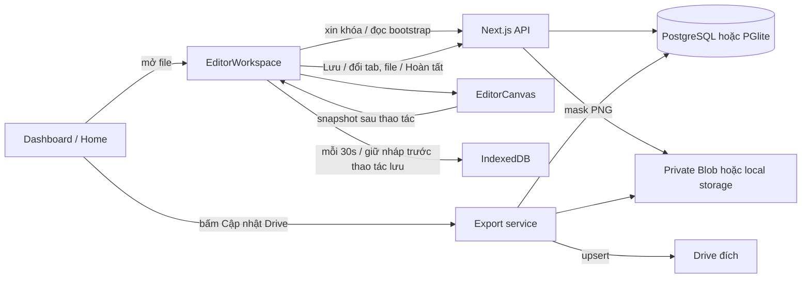

# Kiến trúc hệ thống và bàn giao agent

Cập nhật: 2026-09-09. Đọc tài liệu này cùng [EDITOR_PIPELINE.md](EDITOR_PIPELINE.md) và `../AGENTS.md` trước khi sửa.

## Trạng thái bàn giao

Người dùng yêu cầu dừng triển khai tiếp và ghi lại kiến trúc, kết quả, các việc chưa làm xong. Code trong working tree đã được cập nhật nhưng **chưa commit, chưa deploy, chưa kiểm tra UI bằng trình duyệt, chưa chạy E2E HTTP đầy đủ**. Không coi bản local này là thay đổi đã có trên production.

Đã chạy thành công:

- `npm run typecheck`.
- `npm test`: 18 test, 4 file test.
- `npm run lint`: lần cuối không có lỗi/cảnh báo.
- `npm run build`: Next.js biên dịch và tạo build thành công.
- Đọc trực tiếp database và Google Drive để chẩn đoán; không gọi export/sync production, không chỉnh annotation thật.

Các lệnh trên không thay thế kiểm thử tương tác, race condition trên PostgreSQL thật hoặc xác nhận dữ liệu sau khi ghi lên Drive. Xem phần việc còn lại ở cuối.

## Yêu cầu người dùng đã chốt

1. Chỉ sửa khi cần, đọc code trước, giữ logic hiện có và các chỉnh sửa của người dùng. Không viết lại toàn bộ editor.
2. Tối giản chi tiết thừa, chuyển phần điểm ngắt/nứt gãy trên UI sang tab **Mật độ u vấu**.
3. **“Chấm điểm” nghĩa là point: click chuột tạo tọa độ trên từng u vấu. Không phải score, không dùng thang 1–5 hay 0–3.**
4. Sidebar trái hiển thị danh sách file, trạng thái và cho chuyển file nhanh. File người khác đang sửa vẫn mở được ở chế độ chỉ xem.
5. Lưu nháp local mỗi **30 giây**. Không tự gửi annotation hoặc mask lên server theo timer.
6. Khi đổi tab/file, bấm Lưu, xác nhận thao tác cần lưu hoặc Hoàn tất: gửi lên server. Không báo thành công nếu server từ chối.
7. Drive chỉ ghi khi người dùng bấm **Cập nhật Drive ở Home**. Lưu server và lưu Drive là hai hành động riêng.
8. Một file chỉ có một phiên giữ khóa chỉnh sửa hợp lệ. Backend phải từ chối writer khác và revision cũ; UI phải chặn cả chuột, nút và phím tắt khi chỉ xem/mất khóa.

## Stack và phạm vi

Project root: `SAM/khoqua-mask-editor-react/khoqua-mask-editor-react/annotation-tool`.

- Next.js 16.3.0 App Router, React 19.2.8, TypeScript, React Compiler.
- Frontend và API nằm trong cùng ứng dụng Next.js; không có backend Python cho luồng này.
- PostgreSQL qua `postgres` khi có connection string; PGlite cho development nếu không có connection string.
- Dexie/IndexedDB lưu nháp ở trình duyệt.
- Vercel Blob private lưu mask trên hosting; filesystem dùng khi chạy local không cấu hình Blob.
- OAuth Google ở server dùng để ghi Drive; service account/asset loader dùng đọc dữ liệu nguồn khi phù hợp.
- `sharp` render/chuẩn hóa mask; JSZip tạo gói xuất.

`AGENTS.md` yêu cầu đọc guide của phiên bản Next.js đang cài trong `node_modules/next/dist/docs/`, không dựa hoàn toàn vào kiến thức phiên bản cũ. Đã đọc guide Route Handlers và `useRouter` trong lần sửa này.

## Sơ đồ dữ liệu



Timer heartbeat 30 giây và polling danh sách 8 giây chỉ giữ khóa/đọc trạng thái, **không phải đồng bộ annotation**.

## Bản đồ code

| File | Trách nhiệm |
| --- | --- |
| `src/components/dashboard.tsx` | Chọn project, lọc/mở file, xem file bị khóa, nút Drive/ZIP |
| `src/components/editor-workspace.tsx` | Bootstrap, recovery local, quản lý tab/file, save gate, heartbeat, conflict UI, sidebar |
| `src/components/editor-canvas.tsx` | Polygon/node, point, selection, undo/redo, zoom/pan, render/export canvas; có prop `readOnly` |
| `src/lib/api-client.ts` | Client HTTP, token khóa theo file, gộp request xin khóa đang chạy |
| `src/lib/local-drafts.ts` | Dexie database và khóa nháp theo project/file/user |
| `src/lib/lock-service.ts` | Khóa có TTL, acquire, heartbeat, release |
| `src/lib/annotation-service.ts` | Transaction lưu draft/Done, kiểm tra token và revision, lịch sử version |
| `src/lib/wart-points.ts` | Kiểm tra cấu trúc, trạng thái, tọa độ và ID của point u vấu |
| `src/lib/storage.ts` | PNG validation/normalization, lưu/đọc mask |
| `src/lib/export-service.ts` | Xuất cả DRAFT/DONE, render polygon cũ, JSONL/ZIP, hash và upsert Drive |
| `src/lib/drive-service.ts` | Đọc nguồn, manifest, asset đa loại và thao tác Drive |
| `src/lib/google-oauth.ts` | OAuth config, refresh token mã hóa, access token ở server |
| `src/lib/db.ts` | Adapter Postgres/PGlite, schema, bootstrap admin |
| `src/types/index.ts` | DTO và annotation/local draft types |

## Các API chính

| Endpoint | Hành vi |
| --- | --- |
| `GET /api/projects/:projectId/files` | File list phân trang, annotation state, lock owner, assignment |
| `POST /api/files/:fileId/lock` | Xin khóa; token đang sở hữu có thể dùng lại; phiên khác nhận `FILE_LOCKED` (423) |
| `POST /api/files/:fileId/lock/heartbeat` | Gia hạn TTL nếu user + token hợp lệ |
| `DELETE /api/files/:fileId/lock` | Nhả đúng khóa đang giữ |
| `GET /api/files/:fileId/editor` | Bootstrap cho cả editor và viewer; `readOnly`, `lockedBy`, `lock: null` nếu không sở hữu token |
| `POST /api/files/:fileId/mask` | Upload PNG với khóa hợp lệ |
| `PATCH /api/files/:fileId/annotation` | Lưu draft, tăng revision, kiểm tra lock/revision trong transaction |
| `POST /api/files/:fileId/done` | Validate nhiệm vụ, tạo version, tăng revision, nhả khóa |
| `POST /api/projects/:projectId/export` | Ghi dữ liệu đã lưu server lên Drive; chỉ gọi từ nút Home |
| `GET /api/projects/:projectId/export` | Tải ZIP, không ghi Drive |
| `POST /api/projects/:projectId/sync-drive` | Nhập/cập nhật chỉ mục từ nguồn, khác với export annotation |
| `GET /api/google/diagnostics` | Chẩn đoán quyền thư mục; hiện chọn project đầu tiên, chưa nhận project đang chọn |

Authentication dùng JWT/cookie httpOnly; header khóa là `X-Annotation-Lock-Token`. Không đưa OAuth credential hay refresh token vào client, log hoặc docs.

## Hợp đồng annotation u vấu

Để tránh thay schema SQL và tránh ghi đè điểm đứt gãy cũ, point u vấu được lưu trong **`segmentation.wartPoints`**, thuộc `segmentation_json`:

```json
{
  "segmentation": {
    "humanAction": "MODIFIED",
    "wartPoints": {
      "state": "ANNOTATED",
      "points": [{ "id": "point-id", "x": 120.5, "y": 80.25 }]
    },
    "maskOperations": [{ "type": "POLYGON_SET", "polygons": [] }]
  },
  "breakpoints": { "state": "NOT_ANNOTATED", "points": [] }
}
```

Ví dụ chỉ minh họa cấu trúc. Tọa độ theo pixel ảnh nguồn, không theo màn hình/zoom. `wartPoints.state` có ba giá trị:

- `NOT_ANNOTATED`: chưa làm; được lưu draft, không được Hoàn tất.
- `ANNOTATED`: có ít nhất một point.
- `CONFIRMED_NONE`: đã xác nhận không có u vấu, danh sách rỗng.

**Chi tiết tương thích cần hiểu trước khi sửa:** Canvas hiện tái sử dụng point editor vốn có tên `breakpoints`, `initialBreakpoints`, `confirmNoBreakpoint`. Trong workspace, `snapshot.breakpoints` mang point u vấu; khi gọi API được map sang `segmentation.wartPoints`. `legacyBreakpointsRef` giữ dữ liệu breakpoint cũ và gửi lại trường top-level `breakpoints`. Không đổi tên hay map hai loại dữ liệu này tùy tiện. LocalDraft có `wartPoints` riêng, còn `breakpoints` là dữ liệu legacy.

Annotation cũ không có `wartPoints` mở ra với nhiệm vụ u vấu chưa làm, **không tự diễn giải breakpoint cũ thành u vấu**. Không chạy migration trên dữ liệu thật trong phiên này.

## Lưu local, server và chuyển màn hình

- Snapshot canvas dùng ref để đọc bản mới nhất; `dirtyVersionRef` và `syncedVersionRef` theo dõi thay đổi.
- Timer 30 giây gọi `persistLocal`, không gọi `saveDraft`/`uploadMask`.
- `syncNow` chỉ được gọi bởi các action cần lưu; gửi mask khi MODIFIED và lưu annotation với `baseRevision`.
- Đổi tab workflow, toolbar/phím tắt đổi workflow đi qua `selectTool` và save gate.
- Đổi file/Home qua `navigateTo`: lưu local, chờ server; nếu lỗi thì giữ nguyên file và báo lỗi; thành công mới nhả khóa và chuyển route.
- `visibilitychange` sang hidden yêu cầu lưu server, tương ứng đổi tab trình duyệt. `pagehide` cố giữ local; `beforeunload` cảnh báo khi còn dirty.
- Không bảo đảm upload hoàn tất khi browser/process bị đóng cưỡng bức. Cần kiểm thử browser lifecycle, xem backlog.
- “Đã lưu server” không có nghĩa “Đã lên Drive”. Không gộp lại hai trạng thái này.

## Khóa và conflict

- TTL mặc định 300 giây, cấu hình bằng `LOCK_TTL_SECONDS`; workspace heartbeat mỗi 30 giây.
- Acquire khóa và lưu annotation cùng khóa row `dataset_files` trước, rồi row `file_locks` trong transaction.
- Một phiên khác không được thay live lock, kể cả cùng tài khoản nếu không có token đang sở hữu.
- Save/Done kiểm tra user, token hash, thời gian hết hạn và `baseRevision`; stale writer nhận `LOCK_LOST` hoặc `REVISION_CONFLICT`.
- Bootstrap cho phép viewer đọc annotation nhưng không cấp token.
- Workspace/Canvas đã có disabled controls, pointer/keyboard/imperative guards; cần E2E để xác minh đủ mọi đường tương tác.
- Conflict UI giữ nháp, cho tải JSON local, xem bản local hoặc bỏ local để tải bản server. Đã bỏ đường tự lấy revision mới rồi ghi đè local thành một Done version.
- Không thêm tính năng force unlock hoặc tự giải quyết conflict bằng cách ghi đè.

## Google Drive: phát hiện thực tế

Đã đọc trực tiếp trong phiên 2026-09-09:

| Nguồn | Kết quả |
| --- | --- |
| Website hiện hữu | `https://bitter-melon-annotation.vercel.app` |
| Project | `Bitter Melon V7 Prelabel` |
| Server annotations | 10 bản ghi; cả 10 là DRAFT |
| Lần lưu server mới nhất tại thời điểm kiểm tra | `2026-09-09T03:38:48.472Z` |
| Khóa còn hiệu lực tại thời điểm kiểm tra | 1; không tự nhả hoặc thay khóa này |
| Drive đích | `DATABASE-GT`, ID `147cVK2C7EZiupfMJQntP5Nc6tkkhqchN` |
| Quyền OAuth trên thư mục | `canEdit: true`, `canAddChildren: true` |
| `manifest.jsonl` | 0 bản ghi; modified `2026-09-08T05:37:38.370Z` |
| Nội dung khác ở thư mục gốc | `breakpoints.jsonl`, `masks/`, `DATASET/` |

**Nguyên nhân được xác định trong code cũ:** export lọc `df.annotation_state = 'DONE'`, trong khi toàn bộ annotation server đang là DRAFT. Vì vậy bấm Drive không đưa 10 bản nháp lên manifest. Không phải lỗi thiếu quyền ghi ở lần kiểm tra này. Thông tin trên là snapshot, không phải giám sát realtime.

Các sửa đổi local:

- Export lấy annotation đã lưu server gồm DRAFT và DONE, ghi `annotation_status` vào manifest.
- Xuất `wart-points.jsonl` riêng và giữ `breakpoints.jsonl` cho dữ liệu cũ.
- `manifest.jsonl` có revision/version và hash mask, breakpoint, wart point để bỏ qua bản không đổi.
- Dùng `fetchDatasetAsset`, hỗ trợ nguồn Drive ID, Blob, HTTPS và đường dẫn tuyệt đối; không ép mọi reference thành Google Drive ID.
- Render `POLYGON_SET` từ bản nháp cũ bằng `sharp` khi chưa có raster mới/đang giữ raster cũ. RESET/ACCEPTED dùng prediction. MODIFIED thiếu cả dữ liệu render lẫn raster báo lỗi.
- Home hiển thị lỗi theo file; không chỉ báo số mask upload rồi khiến người dùng hiểu nhầm point/metadata chưa cập nhật.
- Không ghi Drive từ editor, timer, Done hoặc ZIP.

Chưa thực hiện upload thật sau sửa đổi. Agent sau phải phân biệt “mock export tests pass” với “đã xác nhận remote file sau upload”. Chỉ chạy export khi người dùng bấm nút hoặc có chỉ thị mới cho thao tác đó.

## Việc còn lại — ưu tiên trước khi deploy

### 1. Xác minh UI và save policy bằng E2E

Chưa thực hiện vì tool browser trả `No browser is available`. Cần trình duyệt kết nối hoặc test harness phù hợp:

- Tạo/kéo/xóa point u vấu; undo/redo; confirm-none; zoom/pan không đổi tọa độ.
- Sau chỉnh sửa, chờ trên 30 giây: có IndexedDB draft, **không có PATCH annotation, POST mask hoặc POST export** từ timer. Heartbeat/polling GET được phép.
- Chuyển tab workflow bằng nút, toolbar và phím tắt; chuyển tab browser; chuyển file qua sidebar; về Home; Done & Next. Đảm bảo đủ save, không đúp/mất save.
- Giả lập save trả 500/offline/revision conflict: không báo thành công, không rời file khi server save thất bại.
- Hai tài khoản: viewer xem được, mọi đường sửa/save/Done/keyboard/pointer bị chặn. Kiểm tra cả sidebar hẹp/mobile và tab u vấu dài.
- Khôi phục IndexedDB có/không có wartPoints, revision khớp/lệch; legacy breakpoints không mất.

### 2. Rà soát các cạnh tranh và lifecycle còn hở

Các điểm sau được ghi nhận để agent tiếp tục; **chưa sửa/xác minh xong**, không trình bày như đã được bảo đảm:

- Token client hiện nằm trong `Map` bộ nhớ. Hard reload có thể mất token trong khi live lock vẫn tồn tại, khiến cùng tài khoản vào chỉ xem đến khi TTL hết. Thiết kế resume phiên không được cho phiên khác chiếm khóa.
- `syncNow` gộp promise đang chạy, nhưng trả thành công của batch hiện tại. Cần test thay đổi mới phát sinh sát lúc save/chuyển file; bảo đảm flush đến snapshot cuối trước khi nhả khóa.
- Khóa UI đang dựa vào `readOnly`/`status`. `onOffline` đổi status thành OFFLINE; cần giữ chặn chỉnh sửa khi đã conflict/mất khóa, kể cả khi network events đổi status. Backend hiện vẫn kiểm tra khóa trên mỗi lần lưu.
- SPA Back/Forward hoặc unmount ngoài `navigateTo` chưa có kiểm thử flush/release. Pagehide/unload không bảo đảm async IndexedDB/upload hoàn tất.
- `finish` hiện có thể upload mask lần nữa sau `syncNow`; xem xét tái sử dụng mask đã lưu để tránh upload trùng.
- Kiểm thử lỗi IndexedDB sau khi server đã nhận save và lỗi tải bản mới nhất trong conflict dialog; trạng thái phải phản ánh đúng nơi dữ liệu còn tồn tại.
- Test acquire đồng thời hiện chạy trên PGlite, chưa kiểm tra race nhiều server instances trên Postgres thật.

### 3. Kiểm tra Drive sau triển khai được yêu cầu

- Chỉ sau nút Home/chỉ thị người dùng: đọc lại manifest/mask/`wart-points.jsonl` để so revision, số point và tọa độ với server.
- Kiểm tra các bản DRAFT cũ có polygon, raster cũ, RESET và accepted mask.
- Kiểm tra 2 lần bấm Drive đồng thời/nhiều client. Hiện chưa có khóa export liên server; hash/upsert không tự bảo đảm atomic cho nhiều JSONL.
- `GET /api/google/diagnostics` còn chọn project đầu tiên; nếu thêm UI kiểm tra theo project, cần truyền projectId.
- Quyết định chính sách schema/version cho downstream consumer của `annotation_status` và `wart-points.jsonl`; không tự gộp vào breakpoint cũ.

### 4. Kết thúc release

- Review diff với thay đổi đã có trước phiên; chạy lại typecheck/test/lint/build sau mọi sửa code tiếp theo.
- Không commit/deploy/sync chỉ vì tài liệu này đề cập; làm theo yêu cầu mới của người dùng.
- Sau deploy, kiểm tra production UI và luồng Drive thủ công rồi mới đánh dấu các mục tương ứng hoàn tất.

## Môi trường kiểm thử và lưu ý cho agent sau

- Working tree đã có thay đổi từ trước ở README, globals.css, editor-canvas.tsx, editor-workspace.tsx và docs. Không reset hoặc ghi đè toàn bộ các file này.
- Snapshot `src` trước phiên sửa nằm tại `artifacts/before-update/src/` (file TS/TSX đổi đuôi `.bak` để không bị typecheck/lint như source). Artifacts bị gitignore, chỉ có ở workspace này.
- Các test mới: `src/lib/lock-service.test.ts`, `wart-points.test.ts`, `export-service.test.ts`. Lock test dùng PGlite memory; export test mock DB/Drive, không tải lên cloud.
- Dev server thử nghiệm port 3100 đã được dừng khi bàn giao. Chỉ gọi `/api/health`, chưa seed, chưa chạy API mutation E2E.
- `/api/health` chỉ kiểm tra cờ cấu hình Postgres/Blob nên có thể trả 503 khi cố ý chạy PGlite/filesystem; không đủ để kết luận local database hỏng.
- `.env` và `.env.local` có cấu hình production thật. Không gọi `/api/seed` hoặc test mutation trước khi xác minh kết nối đã cách ly. PowerShell gán env chuỗi rỗng có thể xóa biến và khiến Next tải lại `.env`; gọi `@next/env` trước rồi mới override cũng có thể bị cache env khôi phục. Script hỗ trợ local `artifacts/run-isolated-dev.cjs` đã bỏ bước load env trước override; vẫn phải kiểm tra lại isolation trước mutation. Không chép secret vào tài liệu/log.

## Tương thích prelabel — cập nhật 2026-10-30

`prelabel-service.ts` đọc schema `bitter-melon-prelabel-1.0` và `1.1`, nhãn legacy hoặc instance `rN`/`wN`, giữ nguyên hình học và metadata. API editor trả `422 INVALID_ANNOTATION` nếu prelabel không hợp lệ và vẫn bỏ qua prelabel khi đã có annotation lưu trên server. Không đổi schema DB hoặc storage backend. Xem [PRELABEL_COMPATIBILITY.md](PRELABEL_COMPATIBILITY.md).
