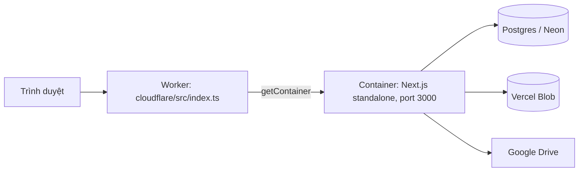

# Triển khai lên Cloudflare Containers

Cập nhật: 2026-10-25. **Trạng thái: đã chuẩn bị code/cấu hình, CHƯA deploy.** Production hiện vẫn chạy trên Vercel (`docs/vercel-cicd.md` ở gốc repo). Tài liệu này mô tả phương án thứ hai chạy song song, không thay thế Vercel.

## Quyết định (người dùng xác nhận 2026-10-25)

Muốn chạy app trên Cloudflare, Worker `khoqua-mask-editor-react` đã nối GitHub qua Workers Builds. Chọn **Cloudflare Containers**: chạy nguyên bản Next.js (standalone) trong container, Worker chỉ làm cổng chuyển tiếp.

Vì sao không chạy trực tiếp trên Workers (OpenNext):

- `@opennextjs/cloudflare@1.20.13` yêu cầu `next >=16.4.1`; dự án dùng `16.3.0` (phải nâng phiên bản).
- `sharp` (chuẩn hóa PNG mask, ZIP/export, thumbnail, polygon export) là module native, không chạy được trên Workers; thay bằng thư viện khác sẽ đụng các đường xử lý pixel-exact.

## Kiến trúc



| Thành phần | File |
| --- | --- |
| Worker + lớp `AppContainer` (chuyển tiếp, truyền biến môi trường vào container, chặn khi thiếu cấu hình) | [cloudflare/src/index.ts](../../cloudflare/src/index.ts) |
| Cấu hình Wrangler (tên Worker, container, Durable Object, `vars`) | [cloudflare/wrangler.jsonc](../../cloudflare/wrangler.jsonc) |
| Image của app (multi-stage, `node:22-bookworm-slim`, `sharp` cài trong Linux) | [annotation-tool/Dockerfile](../Dockerfile) |
| Loại trừ secret/dữ liệu khỏi image | [annotation-tool/.dockerignore](../.dockerignore) |
| `output: 'standalone'` chỉ khi `NEXT_OUTPUT=standalone` (Vercel không bị ảnh hưởng) | [annotation-tool/next.config.ts](../next.config.ts) |

Ràng buộc thiết kế:

- App **không đổi code nghiệp vụ**. Trạng thái nằm ở Postgres, Blob, IndexedDB; container ngủ/thức không mất dữ liệu.
- `db.ts` và `storage.ts` chỉ từ chối fallback (PGlite/filesystem) khi có biến `VERCEL`. Trên Cloudflare không có biến này, nên Worker **trả 503 `NOT_CONFIGURED`** nếu thiếu `SECRET_KEY`, `DATABASE_URL` hoặc `BLOB_READ_WRITE_TOKEN`, tránh ghi vào đĩa tạm của container.
- Một instance dùng chung (`max_instances: 1`, `standard-2` = 1 vCPU / 6 GiB). Khóa file và revision do database bảo đảm nên có thể tăng instance sau, nhưng phải đo bộ nhớ/CPU của export ZIP trước.
- `sleepAfter: 10m`: bộ nhớ và đĩa tính tiền khi instance còn thức; lần mở đầu sau khi ngủ sẽ chậm (cold start).

## Điều kiện cần trước khi deploy

| # | Việc | Ai làm | Trạng thái 2026-10-25 |
| --- | --- | --- | --- |
| 1 | Nâng account lên **Workers Paid** (5 USD/tháng; Containers không có trên gói Free) | Người dùng (thanh toán) | **Chưa**: API trả “requires the Workers Paid plan” |
| 2 | Docker chạy được ở máy deploy (`wrangler deploy` build và đẩy image bằng Docker CLI) hoặc xác nhận Workers Builds build được image | Người dùng | **Chưa**: máy này chưa cài Docker; chưa xác minh Workers Builds |
| 3 | Đặt secret cho Worker (mục dưới) | Người dùng, hoặc Claude khi được duyệt | Chưa |
| 4 | Thêm redirect URI mới trong Google Cloud Console (nếu dùng kết nối Drive qua OAuth) | Người dùng | Chưa |

## Secret và biến môi trường

Giá trị thật lấy từ cấu hình production hiện có (Vercel env / `annotation-tool/.env.local`). **Không dán giá trị vào repo, log hay docs.**

Bắt buộc (Worker từ chối phục vụ nếu thiếu): `SECRET_KEY`, `DATABASE_URL`, `BLOB_READ_WRITE_TOKEN`.
Tùy tính năng: `BLOB_STORE_ID`, `BOOTSTRAP_ADMIN_NAME`, `BOOTSTRAP_ADMIN_EMAIL`, `BOOTSTRAP_ADMIN_PASSWORD`, `GOOGLE_DRIVE_SERVICE_ACCOUNT_JSON`, `GOOGLE_OAUTH_CLIENT_ID`, `GOOGLE_OAUTH_CLIENT_SECRET`, `GOOGLE_OAUTH_REDIRECT_URI`.
Không bí mật (đã ở `vars` trong wrangler.jsonc): `LOCK_TTL_SECONDS`, `LOCK_HEARTBEAT_SECONDS`, `GOOGLE_DRIVE_EXPORT_FOLDER_ID`.

```powershell
cd cloudflare
npx wrangler secret put SECRET_KEY          # nhập giá trị khi được hỏi
npx wrangler secret put DATABASE_URL
npx wrangler secret put BLOB_READ_WRITE_TOKEN
# ... các secret tùy chọn còn lại
```

**Cảnh báo dữ liệu:** dùng cùng `DATABASE_URL` và Blob store như Vercel nghĩa là bản Cloudflare đọc/ghi **cùng dữ liệu thật** (khóa file, lưu, “đặt làm bản chính”). Dùng `SECRET_KEY` giống nhau thì cookie đăng nhập hợp lệ ở cả hai nơi; khác nhau thì phải đăng nhập lại từng nơi. Muốn thử an toàn, tạo database/Blob riêng (ví dụ nhánh Neon) và đặt secret cho chúng trước.

Địa chỉ Worker (subdomain workers.dev của account, kiểm tra 2026-10-25): `https://khoqua-mask-editor-react.aries-anhthu.workers.dev`. Token Cloudflare cho các lệnh `wrangler`/API đặt trong `.env` gốc repo (gitignore) với tên biến chuẩn `CLOUDFLARE_ACCOUNT_ID`, `CLOUDFLARE_API_TOKEN` (cùng `R2_*` chưa dùng); nạp vào shell trước khi chạy wrangler.

`GOOGLE_OAUTH_REDIRECT_URI` phải trỏ về `https://<tên-miền-worker>/api/google/callback` và URI đó phải được thêm vào Google Cloud Console. Nếu không, kết nối Drive từ bản Cloudflare sẽ lỗi.

## Deploy

Từ máy có Docker:

```powershell
cd cloudflare
npm ci
npm run typecheck
npx wrangler deploy
```

Lần đầu sẽ thay Worker mẫu “hello world” (`last_deployed_from: dash_template`) hiện có trong dashboard.

Không có Docker: `npx wrangler deploy --containers-rollout=none` chỉ cập nhật Worker, **không** triển khai container, nên app chưa chạy được.

### Workers Builds (kết nối GitHub)

Đề xuất cấu hình trong dashboard → Worker → Settings → Build:

| Mục | Giá trị |
| --- | --- |
| Root directory | `cloudflare` |
| Build command | `npm ci` |
| Deploy command | `npx wrangler deploy` |
| Production branch | `master` |

Lưu ý:

- Push vào `master` sẽ đồng thời kích hoạt GitHub Actions → Vercel **và** Workers Builds → Cloudflare. Hai bản production cùng dùng một database.
- Nhánh/PR chạy `wrangler versions upload`, không cập nhật image container (theo tài liệu Cloudflare).
- Chưa xác minh Workers Builds có Docker để build image; nếu build lỗi, deploy từ máy có Docker.

## Kiểm tra sau deploy

1. `GET /api/health` trả 200 (nhớ: chỉ kiểm cờ cấu hình, không chứng minh DB đúng).
2. So `fingerprints.database` và `fingerprints.blobStore` giữa Vercel và Cloudflare: trùng ⇒ cùng dữ liệu.
3. Đăng nhập, mở một file (chỉ xem hoặc có khóa), kiểm tra ảnh/mask tải được.
4. Tải ZIP một project nhỏ: xác nhận không hết bộ nhớ/thời gian.
5. Không bấm “Cập nhật Drive” hay “Đặt làm bản chính” trên bản thử khi chưa muốn ghi dữ liệu thật.

## Đã kiểm chứng và chưa kiểm chứng (2026-10-25)

Đã kiểm chứng:

- Token Cloudflare hoạt động (`tokens/verify`: `active`); Worker `khoqua-mask-editor-react` tồn tại (mẫu dashboard, chưa có mã app); R2 chưa được bật trong account.
- `cd cloudflare && npx tsc --noEmit`: sạch.
- `wrangler deploy --dry-run --containers-rollout=none`: bundle Worker 54.54 KiB (gzip 13.63 KiB), cấu hình hợp lệ, binding `APP` và container `khoqua-mask-editor-react-appcontainer` được nhận.
- Build standalone ở bản sao sạch không có file `.env*` (`npm ci` + `NEXT_OUTPUT=standalone npm run build`) thành công; `server.js` nằm ở gốc `.next/standalone`, `sharp` được đóng gói. Chạy thử cô lập: `/login` 200, API chưa đăng nhập 401, `/api/health` 503 `configuration_required` khi thiếu cấu hình. (Chạy trên Windows, chưa phải trong Linux/Docker.)

Chưa kiểm chứng:

- Build image Docker thật và chạy container (chưa có Docker, chưa có gói Paid).
- Hành vi trên Cloudflare: cold start, giới hạn bộ nhớ khi export ZIP, header `Host`/cookie qua Worker, Google OAuth callback.
- Workers Builds có build được image container hay không.
- Giao diện chuột/zoom trên bản Cloudflare (vẫn chưa kiểm thử tương tác trực tiếp như các bản trước).

## Bảo mật

- File `.env` ở gốc repo đang chứa token Cloudflare, khóa R2 và ghi chú dạng văn bản thường. File bị gitignore và chưa được commit, nhưng giá trị đã xuất hiện trong phiên làm việc: **nên xoay (roll) token và khóa R2** sau khi hoàn tất thiết lập, và dùng `wrangler secret put` / biến môi trường thay vì lưu trong file.
- Dùng token quyền tối thiểu (Workers Scripts + Containers + Workers Builds cho deploy). Không gắn token vào `.mcp.json`.
- R2 chưa được app sử dụng; không cấu hình khóa R2 vào Worker cho đến khi có thiết kế dùng R2.

## Hoàn nguyên

Cloudflare là bản song song nên Vercel không bị ảnh hưởng. Để dừng bản Cloudflare: gỡ kết nối Workers Builds, hoặc `npx wrangler delete` (xóa Worker và container). Dữ liệu nằm ở Postgres/Blob nên không mất.
