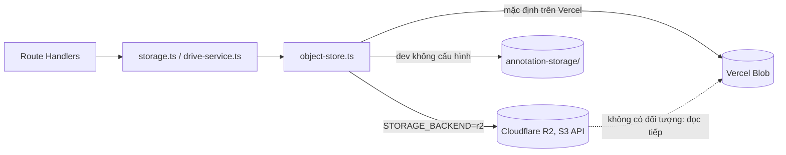

# Lưu file trên Cloudflare R2

Cập nhật: 2026-10-25. **Trạng thái: code đã sẵn sàng và đã kiểm thử bằng mock; CHƯA bật, CHƯA thử với R2 thật.** App vẫn chạy trên Vercel và vẫn lưu file ở Vercel Blob cho đến khi `STORAGE_BACKEND=r2` được đặt.

## Quyết định (người dùng xác nhận 2026-10-25)

Tạm giữ Vercel để chạy app; chuyển nơi lưu file sang Cloudflare R2. Database (Neon Postgres) và Google Drive không đổi. Phương án chạy cả app trên Cloudflare ([CLOUDFLARE_DEPLOY.md](CLOUDFLARE_DEPLOY.md)) tạm dừng.

## Kiến trúc



- [src/lib/object-store.ts](../src/lib/object-store.ts): `putObject`, `getObject` (mask), `getDatasetObject` (tham chiếu `blob:` của dataset), chọn backend bằng `resolveBackend()`. R2 gọi qua S3 API bằng `aws4fetch` (ký SigV4, path-style `https://<account>.r2.cloudflarestorage.com/<bucket>/<key>`).
- [src/lib/storage.ts](../src/lib/storage.ts) chỉ còn chuẩn hóa PNG bằng `sharp` rồi gọi `putObject`/`getObject`; `maskStorageKey` trong database giữ nguyên định dạng `masks/<dataset>/<file>/revisions/<ts>-<uuid>.png`.
- [src/lib/drive-service.ts](../src/lib/drive-service.ts) đọc `blob:<key>` qua `getDatasetObject` (chỉ R2 hoặc Blob, không bao giờ đọc đĩa cục bộ như trước).
- `/api/health`: khóa `blob` là kiểm tra kho lưu trữ nói chung (Blob hoặc R2, tên giữ nguyên cho script cũ); `fingerprints.blobStore` đổi theo kho đang dùng.

### Chọn backend

| `STORAGE_BACKEND` | Kết quả |
| --- | --- |
| (không đặt) | Như cũ: Blob nếu có `VERCEL`/token/store id, ngược lại đĩa cục bộ. **Có biến `R2_*` cũng không tự chuyển sang R2.** |
| `r2` | R2; lỗi rõ ràng nếu thiếu `R2_ENDPOINT`, `R2_BUCKET`, `R2_ACCESS_KEY_ID`, `R2_SECRET_ACCESS_KEY` |
| `blob` / `filesystem` | Ép dùng Blob / đĩa cục bộ |

Chế độ `r2` đọc **liền mạch**: nếu R2 trả 404 và vẫn còn `BLOB_READ_WRITE_TOKEN`, đối tượng được đọc tiếp từ Vercel Blob. Ghi mới luôn vào R2. Lỗi khác 404 từ R2 (403, 5xx) không bị che bằng fallback.

## Quy trình chuyển (làm theo thứ tự)

1. **Bật R2** trong dashboard Cloudflare (R2 Object Storage). Kiểm tra 2026-10-25: API báo “Please enable R2 through the Cloudflare Dashboard” và endpoint S3 của account lỗi bắt tay TLS (curl và Node), nên R2 chưa hoạt động.
2. **Tạo bucket** (ví dụ `khoqua-annotation`), riêng tư, không bật truy cập công khai.
3. **Tạo khóa S3 phạm vi bucket** (Object Read & Write). Khóa hiện có trong `.env` gốc nên được thay bằng khóa bucket-scoped; đã xuất hiện trong phiên làm việc nên cũng cần xoay.
4. **Chạy thử** (chỉ đọc Blob, HEAD R2, không ghi gì):
   ```powershell
   cd annotation-tool
   node --env-file=.env.local scripts/migrate-blob-to-r2.mjs
   ```
   Cần `BLOB_READ_WRITE_TOKEN` và các biến `R2_*` trong môi trường (thêm `R2_BUCKET`).
5. **Backup trước khi chép** theo `scripts/backup-server.mjs` (database snapshot + Blob) ngoài repo.
6. **Chép thật** (chỉ ghi vào R2, không sửa/xóa Blob hay database; bỏ qua đối tượng đã có cùng kích thước, chạy lại được):
   ```powershell
   node --env-file=.env.local scripts/migrate-blob-to-r2.mjs --apply
   ```
7. **Đặt biến trên Vercel** (Project → Settings → Environment Variables): `STORAGE_BACKEND=r2`, `R2_ENDPOINT`, `R2_BUCKET`, `R2_ACCESS_KEY_ID`, `R2_SECRET_ACCESS_KEY` (loại *Sensitive*), rồi redeploy. **Giữ nguyên** `BLOB_READ_WRITE_TOKEN` để còn fallback.
8. **Kiểm tra**: `/api/health` 200 với `fingerprints.blobStore` đã đổi; mở file đã có mask, lưu một thay đổi nhỏ trên file thử, tải ZIP.
9. Khi mọi thứ ổn định một thời gian và xác nhận R2 đủ dữ liệu, mới cân nhắc bỏ `BLOB_READ_WRITE_TOKEN`.

**Hoàn nguyên:** bỏ `STORAGE_BACKEND` (hoặc đặt `blob`) và redeploy. Mask ghi mới trong thời gian chạy R2 chỉ nằm ở R2, nên trước khi quay lại phải chạy chiều ngược lại (hiện chưa có script) hoặc chấp nhận chúng không đọc được từ Blob. Do đó chỉ chuyển sau khi đã thử trên file thử.

## Script thao tác dữ liệu vẫn dùng Vercel Blob

`backup-server.mjs`, `fetch-ground-truth.mjs`, `import-*.mjs`, `upload-blob-dataset.mjs`, `setup-blob-dataset.mjs` chưa hỗ trợ R2. Sau khi chuyển sang R2: `import-*`/`upload-*` ghi vào **Blob**, không phải R2; `backup-server`/`fetch-ground-truth` chỉ thấy dữ liệu còn nằm trong Blob. Cần cập nhật các script này trước khi ngừng dùng Blob.

## Đã kiểm chứng và chưa kiểm chứng (2026-10-25)

Đã kiểm chứng:

- `src/lib/object-store.test.ts`: 15 test (chọn backend, R2 PUT/GET ký SigV4 path-style, 403/404, fallback Blob, không che lỗi R2, hành vi Blob cũ, đĩa cục bộ, chặn khóa `..`).
- `npm run typecheck` sạch; `npm test` 113 test / 18 file qua (98 cũ + 15 mới); `npm run lint` sạch; `npm run build` thành công.
- `scripts/migrate-blob-to-r2.mjs` qua `node --check`.

Chưa kiểm chứng:

- Mọi thứ với R2 thật (R2 chưa bật; endpoint lỗi TLS). Đặc biệt: chữ ký SigV4 với R2, `HEAD`/`content-length`, kích thước lớn.
- `scripts/migrate-blob-to-r2.mjs` chưa chạy (cả dry-run), vì cần R2 hoạt động.
- Độ trễ đọc ảnh/mask qua R2 từ server Vercel (chưa đo).
- Không có test tích hợp route với R2; các route vẫn gọi qua `storage.ts`/`drive-service.ts` như trước.
