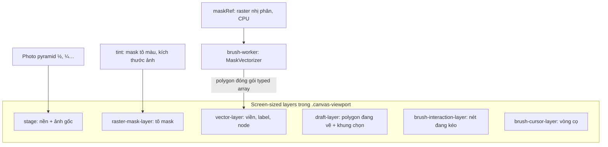

# Render editor: thuật toán tối ưu và số đo

Cập nhật: 2026-10-25. Trạng thái: đã code, có unit test và kiểm tra tự động trên Chrome headless (trang dữ liệu giả `/canvas-browser-check`); **chưa thử trên thiết bị thật, dữ liệu thật, Safari/Firefox; chưa commit**; đã deploy Vercel 2026-10-25 (deployment `bitter-melon-annotation-q3f7ls3bn`, từ working tree, chưa commit).

Đọc cùng [EDITOR_PIPELINE.md](EDITOR_PIPELINE.md) (hợp đồng thao tác) và [ARCHITECTURE.md](ARCHITECTURE.md).

## 1. Yêu cầu (người dùng xác nhận 2026-10-25)

Editor phải mượt trên thiết bị yếu khi vẽ/tẩy (paint), chỉnh segment, zoom in/out, tải ảnh và chuyển brush ↔ polygon; tìm hiểu thuật toán tối ưu render; **không phá vỡ tính năng hiện có**, đặc biệt **undo từng điểm khi đang vẽ polygon** (chấm nhiều điểm, Ctrl+Z gỡ điểm vừa chấm).

## 2. Cách đo

- Kịch bản: [`scripts/canvas-browser-check.mjs`](../scripts/canvas-browser-check.mjs) điều khiển Chrome headless qua DevTools Protocol trên `/canvas-browser-check` (không gọi API, không chạm DB/Blob/Drive). Ba cảnh: mặc định 800×500 (kiểm chức năng), `?many=1` 2400×1600 với **600 polygon đã lưu**, `?spiky=1` 1600×1000 chỉ có raster.
- Đo dưới **CPU giới hạn 4×**, render phần mềm của headless (gần thiết bị yếu): long task (> 50 ms trên main thread), khoảng cách khung hình p95, CPU profile (`PROFILE=<tên bước>`).
- Số đo là tương đối (dev build, máy phát triển); dùng để so trước/sau, không phải cam kết hiệu năng.

## 3. Kiến trúc lớp canvas

Mỗi lớp có cờ bẩn riêng trong `dirtyRef` và chỉ vẽ lại khi nội dung của chính nó đổi:

| Lớp | Vẽ lại khi | Không vẽ lại khi |
| --- | --- | --- |
| `stage` (ảnh) | đổi view (zoom/pan), đổi kích thước, mất GPU context | chọn, kéo node, chấm điểm, nét brush, vector hóa |
| `draft` | chấm/gỡ điểm, di chuột xem trước cạnh, kéo khung chọn, đổi view | mọi thứ khác |
| `mask` | đổi mask (`maskRect` = chỉ vùng nét brush), zoom settle | kéo node, chấm điểm |
| `vectors` | đổi polygon/chọn (`vectorsRect` = chỉ vùng kéo node), zoom settle | nét brush |

## 4. Thuật toán theo tình huống

### 4.1 Zoom / pan

- Trong cử chỉ: chỉ vẽ lại `stage` và `draft`; lớp mask/vector được **dịch bằng CSS transform trên GPU** từ view lúc vẽ, vẽ lại sắc nét 120 ms sau khi dừng (đã có từ trước).
- **Image pyramid (mipmap)**: sau khi tải, mỗi lúc rảnh (`requestIdleCallback`) dựng một mức ½, ¼… (mỗi mức thu nhỏ từ mức trước, trung bình như box filter) cho ảnh có cạnh ≥ 1024 px. Khi thu nhỏ, `stage` lấy mức thô nhất vẫn ≥ 1 texel/pixel thiết bị (`photoLevelFor`), thay vì resample toàn ảnh mỗi khung hình. Phóng to dùng ảnh gốc (giữ “pixel thật” như cũ). Mất GPU context thì dựng lại.
- Chỉ vẽ phần ảnh trong viewport, `image.decode()` trước khi vẽ khung đầu (giải mã ngoài main thread).
- **Tỉ lệ pixel thích ứng thiết bị** (`renderPixelRatio`): tối đa 1.5×; máy báo `navigator.deviceMemory` < 4 GB vẽ 1× (6 lớp toàn màn hình được xóa/ghép mỗi khung).

### 4.2 Vẽ / tẩy brush

- Nét đang kéo vẽ trên lớp tương tác, gom sự kiện `getCoalescedEvents` theo `requestAnimationFrame` (đã có).
- Commit nét chỉ đổi vùng bounds của nét trên mask/tint và chỉ vẽ lại vùng đó của lớp mask (đã có). **Không còn vẽ lại ảnh gốc** sau mỗi nét.
- Khôi phục vùng polygon khóa (copy từ `lockedMask`) **bỏ qua khi không có polygon nào khóa** (trước đây luôn copy một vùng trong suốt).
- **Worker khởi tạo từ polygon** (`INIT_POLYGONS`): khi raster được dựng từ `POLYGON_SET`, worker nhận hình học polygon đóng gói (vài typed array) và tự rasterize cùng quy tắc tâm pixel, thay cho `getImageData` toàn ảnh + chuyển 15–48 MB trên main thread ngay sau nét đầu tiên. Raster mode (không có polygon) vẫn dùng `INIT_MASK` như cũ. Kiểm chứng: cùng chuỗi nét trên cảnh 600 polygon cho đúng **510** thành phần trước và sau thay đổi.

### 4.3 Chỉnh node / segment (Select)

- **Dirty rectangle cho lớp vector**: khi kéo node, mỗi khung chỉ thay vùng = hợp của “phạm vi vẽ” cũ và mới của các polygon đang di chuyển (viền + node + tag label, `vectorExtent`). Các polygon chạm vùng đó được vẽ **không clip** vào back buffer rồi copy đúng hình chữ nhật (căn theo pixel thiết bị) sang lớp: mỗi pixel trong vùng được raster y hệt vẽ lại toàn bộ. (Bản dùng `clip()` lệch antialias ở mép vùng clip — đo khi canvas chạy raster CPU như trên máy không có GPU — nên không dùng; back buffer đúng theo cấu tạo trên cả hai đường.) Kiểm chứng bằng ảnh chụp ghép lớp: giữa lúc kéo, khung dirty-rect **trùng từng pixel** với khung vẽ lại toàn bộ.
- Lưới khử trùng node 8 px ở mép vùng: lọc node rộng thêm 16 px để cùng tập node như vẽ toàn bộ.
- Thả chuột commit polygon và vẽ lại toàn bộ như cũ.

### 4.4 Tải ảnh

- File có `POLYGON_SET` là thao tác cuối: polygon chính là mask, nên **không tải, không giải mã, không chuẩn hóa mask đã lưu** (trước đây chuẩn hóa rồi ghi đè ngay). Raster nhị phân dựng lười từ polygon khi cần (brush/export).
- Mask dự đoán chỉ được **chuẩn hóa khi bấm Khôi phục/Giữ mask gợi ý** (`ensurePrediction`), không còn chuẩn hóa mỗi lần mở.
- Chuẩn hóa mask (khi cần) xử lý từng word 32-bit (`normalizeMaskRgba`), kết quả bằng hệt vòng lặp từng byte cũ (có test).
- Sửa lỗi kèm theo: `POLYGON_SET` rỗng trước đây để raster dự đoán/đã lưu trong bộ nhớ dù màn hình không hiện mask, nên nét brush đầu tiên “làm sống lại” vùng dự đoán. Nay raster luôn khớp polygon (rỗng).

### 4.5 Chuyển polygon → brush

- Raster nhị phân dựng **chỉ trong hình chữ nhật pixel của polygon** (`polygonPixelRect`), ghi thẳng từng đoạn quét vào word 32-bit (`forEachPolygonSpan`), chỉ xóa các dải ngoài hình chữ nhật. Bỏ vòng lặp chuyển đổi từng pixel và ImageData toàn ảnh.
- Việc dựng chạy lúc main thread rảnh ngay sau khi đổi công cụ (thanh công cụ phản hồi trước); nét bắt đầu sớm hơn thì dựng đồng bộ như cũ.

### 4.6 Chuyển brush → polygon (vector hóa)

- Kết quả worker gửi **đóng gói typed array có transfer** (`polygon-pack.ts`): tọa độ + cấu trúc ring, id node dựng lại theo quy tắc `${polygonId}-${outer|holeN}-${i}` của vectorizer (id bất thường thì gửi kèm). JSON lưu ra giống từng byte (có test). Trước đây structured clone hàng trăm nghìn object node tốn ~366 ms main thread (4×).
- Gán lại id/label/meta cũ theo IoU bounding box dùng **lưới đều** thay cho quét O(n²); duyệt ứng viên theo thứ tự gốc nên kết quả giống hệt bản quét toàn bộ (có test so sánh).
- `polygonBounds` không còn tạo một object cho mỗi node.
- **LOD hiển thị**: đơn giản hóa viền theo zoom dùng radial-distance (O(n), một nửa dung sai) rồi Douglas–Peucker (cách của simplify.js); sai lệch ≤ 1.5 × dung sai (có test). Chỉ dùng để vẽ, không bao giờ lưu hay rasterize khi export.

### 4.7 Vẽ polygon (công cụ P)

- Polygon đang vẽ và khung chọn nằm ở lớp `draft` riêng: di chuột xem trước cạnh không vẽ lại ảnh gốc.
- Lịch sử điểm tách thành `PolygonDraft` (`src/lib/polygon-draft.ts`) giữ **nguyên hành vi cũ**: mỗi lần chấm/xóa điểm là một bước; Ctrl+Z gỡ đúng điểm vừa chấm; Ctrl+Y/Ctrl+Shift+Z chấm lại; gỡ hết điểm thì undo tiếp chuyển sang lịch sử chung; double-click bỏ đỉnh trùng; chuột phải xóa điểm và hoàn tác được. Khóa bằng `polygon-draft.test.ts` và kịch bản trình duyệt.

## 5. Kết quả đo (4× CPU, cảnh 600 polygon trừ khi ghi khác)

| Bước | Trước | Sau |
| --- | --- | --- |
| Brush → Select (vector hóa) | long task 777–825 ms (lớn nhất ~450 ms) | 223–308 ms (lớn nhất ~170–210 ms) |
| 3 nét brush đầu tiên | 111–176 ms (đồng bộ worker) | 0 |
| Polygon → Brush | 203–261 ms trong cú click | 160–238 ms, chạy lúc rảnh sau khi thanh công cụ đã vẽ |
| Kéo node: khoảng khung p95 | 50 ms | 17 ms |
| Di chuột + chấm 6 điểm polygon | 0 long task (nhưng vẽ lại ảnh gốc mỗi lần di chuột) | 0 long task, không vẽ lại ảnh |
| Mở file polygon (CPU profile) | ~500 ms chuẩn hóa mask/dự đoán (normalizeMask 237, getImageData 158, clearRect 82, putImageData 26 ms) | không còn |
| Zoom in/out 24 lần, cảnh raster | 0 long task | 0 long task |

CPU profile bước Brush → Select: giải tuần tự hóa kết quả worker 366 → 22 ms; ghép id theo IoU ~105 → ~14 ms; `polygonBounds` 88 → 33 ms; LOD (`segmentDistance` + `simplifyClosed`) 158 → ~95 ms.

Hạn chế của số đo: long task lúc tải ở bản cũ không đo được (cửa sổ đo sai trước khi sửa script), nên dùng CPU profile; số đo của Chrome headless render phần mềm, chưa phải thiết bị thật.

## 6. Invariant khi sửa render

- Không vẽ lại `stage` cho thay đổi nội dung (chọn, kéo node, chấm điểm, nét brush); thứ gì cần cập nhật theo nội dung phải nằm ở lớp khác (ví dụ lớp `draft`).
- Partial redraw (mask/vector) chỉ hợp lệ khi lớp đang thẳng hàng với view hiện tại; ngược lại vẽ toàn bộ.
- Raster nhị phân phải đúng từng pixel với `rasterizePolygons` (tâm pixel, evenodd, không antialias). `forEachPolygonSpan`/`polygonPixelRect` có test đối chiếu với bản rasterizer trước đây.
- Worker và main thread phải giữ cùng raster: `INIT_POLYGONS` dùng đúng tập polygon `drawable` của `ensureMaskRaster`; sau đó mọi nét gửi `PUT_PATCH`.
- LOD và pyramid chỉ dùng để hiển thị.
- Không đọc ngược (`getImageData`) các lớp hiển thị: Chrome sẽ chuyển canvas đó sang raster CPU và vẽ chậm hẳn. Chỉ `maskRef` (tạo với `willReadFrequently`) được đọc.

## 7. Đã cân nhắc nhưng không làm

| Phương án | Lý do không làm |
| --- | --- |
| Render toàn bộ trong worker (`transferControlToOffscreen`) hoặc WebGL | Viết lại editor (bị cấm); hit-test/sự kiện phải đồng bộ qua worker |
| Gộp mọi polygon vào một `Path2D` để tô một lần | evenodd giữa các polygon chồng nhau sẽ khoét lỗ sai |
| Vẽ mask polygon từ tint khi zoom ≤ 1 | Cần thêm một canvas cỡ ảnh (tốn bộ nhớ thiết bị yếu) hoặc lệch so với polygon đã làm mịn |
| Giữ đỉnh gốc của polygon không bị nét brush chạm | Hiện lần brush đầu dò lại mọi polygon từ raster (hành vi có sẵn); đổi là đổi hành vi, cần người dùng quyết định |
| Giảm ngân sách bộ nhớ undo trên máy yếu | Đổi số bước undo nhìn thấy được |
| Dirty rect bằng `clip()` | Antialias ở mép clip lệch so với vẽ toàn bộ (đo trên raster CPU: ~300 pixel lệch nhẹ mỗi khung kéo) |

## 8. Chưa kiểm chứng / việc còn lại

- Thiết bị thật (điện thoại, tablet, laptop yếu, GPU bị chặn), ảnh thật 12 MP với ~1600 polygon, production build.
- Safari (không có `requestIdleCallback`: dùng `setTimeout`), Firefox; `navigator.deviceMemory` chỉ có trên Chromium.
- Mất GPU context thật (dựng lại pyramid) và bộ nhớ của pyramid (~⅓ ảnh gốc).
- Polygon → Brush trên ảnh đầy polygon vẫn ~200 ms (4×) cho rasterize; có thể chuyển hẳn sang worker nếu cần.
