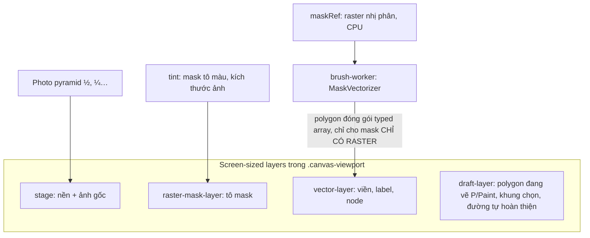

# Render editor: thuật toán tối ưu và số đo

Cập nhật: 2026-11-12 — Paint (B) sửa thẳng trên polygon, bỏ lớp nét brush/vòng cọ và việc vector hóa sau khi tô; thêm gợi ý neo trên lớp `vectors` (§4.2, §4.8, §5b). Phần còn lại ghi theo đợt tối ưu 2026-10-25. Trạng thái đợt 2026-10-25: đã code, có unit test và kiểm tra tự động trên Chrome headless (trang dữ liệu giả `/canvas-browser-check`); **chưa thử trên thiết bị thật, dữ liệu thật, Safari/Firefox; chưa commit**; đã deploy Vercel 2026-10-25 (deployment `bitter-melon-annotation-q3f7ls3bn`, từ working tree, chưa commit).

Đọc cùng [EDITOR_PIPELINE.md](EDITOR_PIPELINE.md) (hợp đồng thao tác) và [ARCHITECTURE.md](ARCHITECTURE.md).

## 1. Yêu cầu (người dùng xác nhận 2026-10-25)

Editor phải mượt trên thiết bị yếu khi vẽ/tẩy (paint), chỉnh segment, zoom in/out, tải ảnh và chuyển brush ↔ polygon; tìm hiểu thuật toán tối ưu render; **không phá vỡ tính năng hiện có**, đặc biệt **undo từng điểm khi đang vẽ polygon** (chấm nhiều điểm, Ctrl+Z gỡ điểm vừa chấm).

## 2. Cách đo

- Kịch bản: [`scripts/canvas-browser-check.mjs`](../scripts/canvas-browser-check.mjs) điều khiển Chrome headless qua DevTools Protocol trên `/canvas-browser-check` (không gọi API, không chạm DB/Blob/Drive). Ba cảnh: mặc định 800×500 (kiểm chức năng), `?many=1` 2400×1600 với **600 polygon đã lưu**, `?spiky=1` 1600×1000 chỉ có raster.
- Đo dưới **CPU giới hạn 4×**, render phần mềm của headless (gần thiết bị yếu): long task (> 50 ms trên main thread), khoảng cách khung hình p95, CPU profile (`PROFILE=<tên bước>`).
- Số đo là tương đối (dev build, máy phát triển); dùng để so trước/sau, không phải cam kết hiệu năng.

## 3. Kiến trúc lớp canvas

Từ 2026-11-12 không còn `brush-interaction-layer` / `brush-cursor-layer`: Paint vẽ polygon trên lớp `draft` như công cụ P. `maskRef` chỉ còn dùng để xuất PNG (dựng lười từ polygon) và để chuyển một lần mask chỉ có raster (mask dự đoán, Khôi phục mask ban đầu, annotation brush cũ) sang polygon.

**Hiển thị ảnh để xem dễ hơn (2026-11-16, người dùng xác nhận; chỉ đổi hiển thị, mask/export giữ nguyên):**

- **Độ sáng**: CSS `filter: brightness(x)` đặt trên RIÊNG phần tử canvas `stage` — composite trên GPU, không vẽ lại pixel nào, các lớp mask/viền/điểm không đổi màu.
- **Làm rõ biên**: unsharp mask `out = ảnh + strength × (ảnh − blur 2 px)` tính MỘT LẦN trên ảnh nguồn khi đổi giá trị (debounce 200 ms; ~60 ms với ảnh 2 Mpx, một vòng `Uint8ClampedArray`, blur bằng `ctx.filter` tăng tốc GPU). Kết quả thay nguồn vẽ của `stage` và pyramid (`enhancedPhotoRef`), nên pan/zoom sau đó không tốn thêm gì — đây là lý do không dùng SVG `feConvolveMatrix` theo frame. `strength = 0` trả về ảnh gốc và dựng lại pyramid gốc.
- **Minimap** (`canvas-minimap.tsx`, sidebar trái): hiển thị bằng chính `` ảnh gốc (trình duyệt cache, scale GPU) + khung đỏ từ `onViewChange` của canvas (gọi trong `renderView`/`fit`); bấm/kéo gọi `EditorCanvasHandle.panTo`. Không canvas phụ, không vẽ lại theo frame.

Mỗi lớp có cờ bẩn riêng trong `dirtyRef` và chỉ vẽ lại khi nội dung của chính nó đổi:

| Lớp | Vẽ lại khi | Không vẽ lại khi |
| --- | --- | --- |
| `stage` (ảnh) | đổi view (zoom/pan), đổi kích thước, mất GPU context | chọn, kéo node, chấm điểm, áp dụng Paint, vector hóa |
| `draft` | chấm/gỡ điểm, di chuột xem trước cạnh/điểm neo, Shift xem trước tự hoàn thiện, kéo khung chọn, đổi view, đổi +/− của Paint | mọi thứ khác |
| `mask` | đổi mask (polygon commit), zoom settle | kéo node, chấm điểm |
| `vectors` | đổi polygon/chọn (`vectorsRect` = chỉ vùng kéo node), zoom settle, đổi độ mờ hoặc chế độ màu theo label (2026-11-05), đổi tool, bắt đầu/kết thúc kéo node (gợi ý neo, 2026-11-12) | di chuột |

Thanh cuộn (2026-11-05) là hai `div` HTML trên `.canvas-viewport`, cập nhật mỗi khi lớp `stage` vẽ lại (mọi thay đổi view); kéo thumb chỉ đổi `viewRef` rồi `renderView()` như pan. Vòng chỉ báo magnet vẽ trên lớp `draft`.

Độ mờ của lớp `mask` là CSS `opacity` (không vẽ lại); viền trên lớp `vectors` nhận cùng độ mờ qua `globalAlpha` khi vẽ, còn node và tag label vẽ với alpha 1 nên đổi độ mờ phải vẽ lại lớp `vectors`. Đổi chế độ màu theo label vẽ lại `mask` và `vectors`. Không vẽ lại `stage`. Chế độ màu áp dụng giống nhau ở vẽ toàn bộ và dirty rectangle (kiểm tra trùng pixel vẫn qua).

## 4. Thuật toán theo tình huống

### 4.1 Zoom / pan

- Trong cử chỉ: chỉ vẽ lại `stage` và `draft`; lớp mask/vector được **dịch bằng CSS transform trên GPU** từ view lúc vẽ, vẽ lại sắc nét 120 ms sau khi dừng (đã có từ trước).
- **Image pyramid (mipmap)**: sau khi tải, mỗi lúc rảnh (`requestIdleCallback`) dựng một mức ½, ¼… (mỗi mức thu nhỏ từ mức trước, trung bình như box filter) cho ảnh có cạnh ≥ 1024 px. Khi thu nhỏ, `stage` lấy mức thô nhất vẫn ≥ 1 texel/pixel thiết bị (`photoLevelFor`), thay vì resample toàn ảnh mỗi khung hình. Phóng to dùng ảnh gốc (giữ “pixel thật” như cũ). Mất GPU context thì dựng lại.
- Chỉ vẽ phần ảnh trong viewport, `image.decode()` trước khi vẽ khung đầu (giải mã ngoài main thread).
- **Tỉ lệ pixel thích ứng thiết bị** (`renderPixelRatio`): tối đa 1.5×; máy báo `navigator.deviceMemory` < 4 GB vẽ 1× (6 lớp toàn màn hình được xóa/ghép mỗi khung).

### 4.2 Paint (từ 2026-11-12; thay cho vẽ / tẩy brush)

- Người dùng xác nhận 2026-11-12: Paint vẽ polygon như P rồi **nối (+) / trừ (−)** bằng phép boolean polygon (`src/lib/polygon-paint.ts`), không tô pixel, không vector hóa lại khi rời Paint. Mask khác không bao giờ bị gộp (bản brush cũ dò lại thành phần liên thông nên các mask chạm nhau "dính" thành một; kịch bản cũ ghi nhận 600 → 510 thành phần).
- Commit là một `commitPolygons` như mọi thao tác polygon: dựng lại tint từ polygon, một bước history (`HistoryEntry` chỉ còn kiểu `polygons`, bỏ ảnh chụp pixel trước/sau và ngân sách 96 MB).
- Kết quả clipping được gắn lại đỉnh gốc bằng `restoreSourceVertices` (`geometry-primitives.ts`): cạnh nối hai đỉnh gốc liền nhau bỏ qua tra cứu, chỉ cạnh mới tra lưới đỉnh; chỉ mục dựng một lần cho mọi vòng. `ringSelfIntersects` dùng lưới cho ring > 64 đỉnh (cùng kết quả với vòng O(n²), có test so 120 ring ngẫu nhiên). Hai sửa này đưa Paint (−) trên mask raster lớn (`?spiky=1`) từ long task 41 s xuống ~1.5 s (4× CPU).
- Đã xóa: lớp nét đang kéo/vòng cọ, `commitBrushStroke`, worker `INIT_POLYGONS`/`PUT_PATCH`/`APPLY_STROKE`, mask bảo vệ pixel khóa (`lockedMask`). *Lịch sử 2026-10-25 (không còn áp dụng):* worker khởi tạo từ polygon, commit nét theo bounds, bỏ copy `lockedMask` khi không có polygon khóa.

### 4.3 Chỉnh node / segment (Select)

- **Dirty rectangle cho lớp vector**: khi kéo node, mỗi khung chỉ thay vùng = hợp của “phạm vi vẽ” cũ và mới của các polygon đang di chuyển (viền + node + tag label, `vectorExtent`). Các polygon chạm vùng đó được vẽ **không clip** vào back buffer rồi copy đúng hình chữ nhật (căn theo pixel thiết bị) sang lớp: mỗi pixel trong vùng được raster y hệt vẽ lại toàn bộ. (Bản dùng `clip()` lệch antialias ở mép vùng clip — đo khi canvas chạy raster CPU như trên máy không có GPU — nên không dùng; back buffer đúng theo cấu tạo trên cả hai đường.) Kiểm chứng bằng ảnh chụp ghép lớp: giữa lúc kéo, khung dirty-rect **trùng từng pixel** với khung vẽ lại toàn bộ.
- Lưới khử trùng node 8 px ở mép vùng: lọc node rộng thêm 16 px để cùng tập node như vẽ toàn bộ.
- Thả chuột commit polygon và vẽ lại toàn bộ như cũ.

### 4.4 Tải ảnh

- File có `POLYGON_SET` là thao tác cuối: polygon chính là mask, nên **không tải, không giải mã, không chuẩn hóa mask đã lưu** (trước đây chuẩn hóa rồi ghi đè ngay). Raster nhị phân dựng lười từ polygon khi cần (export).
- Mask dự đoán chỉ được **chuẩn hóa khi bấm Khôi phục/Giữ mask gợi ý** (`ensurePrediction`), không còn chuẩn hóa mỗi lần mở.
- Chuẩn hóa mask (khi cần) xử lý từng word 32-bit (`normalizeMaskRgba`), kết quả bằng hệt vòng lặp từng byte cũ (có test).
- Sửa lỗi kèm theo: `POLYGON_SET` rỗng trước đây để raster dự đoán/đã lưu trong bộ nhớ dù màn hình không hiện mask, nên nét brush đầu tiên “làm sống lại” vùng dự đoán. Nay raster luôn khớp polygon (rỗng).

### 4.5 Dựng raster nhị phân từ polygon (export)

- Raster nhị phân dựng **chỉ trong hình chữ nhật pixel của polygon** (`polygonPixelRect`), ghi thẳng từng đoạn quét vào word 32-bit (`forEachPolygonSpan`), chỉ xóa các dải ngoài hình chữ nhật. Bỏ vòng lặp chuyển đổi từng pixel và ImageData toàn ảnh. Từ 2026-11-12 chỉ chạy khi xuất PNG (Paint không cần raster nên không còn dựng lúc đổi sang Paint).

### 4.6 Chuyển mask chỉ có raster → polygon (vector hóa một lần)

Từ 2026-11-12 chỉ dùng cho mask chưa có polygon (mask dự đoán PNG, "Khôi phục mask ban đầu", annotation cũ lưu bằng nét brush) khi vào công cụ polygon/Paint; không còn chạy sau khi tô.

- Kết quả worker gửi **đóng gói typed array có transfer** (`polygon-pack.ts`): tọa độ + cấu trúc ring, id node dựng lại theo quy tắc `${polygonId}-${outer|holeN}-${i}` của vectorizer (id bất thường thì gửi kèm). JSON lưu ra giống từng byte (có test). Trước đây structured clone hàng trăm nghìn object node tốn ~366 ms main thread (4×).
- Gán lại id/label/meta cũ theo IoU bounding box dùng **lưới đều** thay cho quét O(n²); duyệt ứng viên theo thứ tự gốc nên kết quả giống hệt bản quét toàn bộ (có test so sánh).
- `polygonBounds` không còn tạo một object cho mỗi node.
- **LOD hiển thị**: đơn giản hóa viền theo zoom dùng radial-distance (O(n), một nửa dung sai) rồi Douglas–Peucker (cách của simplify.js); sai lệch ≤ 1.5 × dung sai (có test). Chỉ dùng để vẽ, không bao giờ lưu hay rasterize khi export.

### 4.7 Vẽ polygon (công cụ P)

- Polygon đang vẽ và khung chọn nằm ở lớp `draft` riêng: di chuột xem trước cạnh không vẽ lại ảnh gốc.
- Lịch sử điểm tách thành `PolygonDraft` (`src/lib/polygon-draft.ts`) giữ **nguyên hành vi cũ**: mỗi lần chấm/xóa điểm là một bước; Ctrl+Z gỡ đúng điểm vừa chấm; Ctrl+Y/Ctrl+Shift+Z chấm lại; gỡ hết điểm thì undo tiếp chuyển sang lịch sử chung; double-click bỏ đỉnh trùng; chuột phải xóa điểm và hoàn tác được. Khóa bằng `polygon-draft.test.ts` và kịch bản trình duyệt. Paint (2026-11-12) dùng chung bản nháp và cùng hợp đồng này.

### 4.8 Gợi ý neo (2026-11-12)

- Người dùng yêu cầu 2026-11-12: ở P/Paint, và khi đang kéo node trong Select, các đỉnh của polygon khác trong khung nhìn hiện chấm rỗng 2 px (nền trắng, viền màu label; mask khóa viền xám) để biết đưa chuột tới đâu.
- Vẽ trên lớp `vectors` cùng vòng lặp với viền, gom theo màu vào một `Path2D`, khử trùng bằng lưới 8 px màn hình (helper `addGridDots`, dùng chung với handle của polygon đang chọn). Bỏ qua polygon có hộp bao trên màn hình < 24 px. Chỉ vẽ lại khi lớp `vectors` vốn đã vẽ lại (đổi view, polygon, tool, bắt đầu/kết thúc kéo), **không theo từng lần rê chuột**; dirty rectangle khi kéo node vẽ chấm theo cùng quy tắc (kiểm tra "dirty-rectangle redraw equals a full redraw" vẫn qua).

### 4.9 Tự hoàn thiện (Shift) — lõi `mask-anchor.ts` (2026-11-12)

- Mô hình biên (lưới đoạn + lưới đỉnh, đồ thị chạm theo nhu cầu, vòng hợp của từng nhóm) cache theo danh tính mảng polygon; rê chuột/kéo node trên cùng mảng chỉ chiếu điểm lên vòng và chọn chiều (2 phép `polygon-clipping` intersection).

## 5. Kết quả đo (4× CPU, cảnh 600 polygon trừ khi ghi khác)

| Bước | Trước | Sau |
| --- | --- | --- |
| Brush → Select (vector hóa) | long task 777–825 ms (lớn nhất ~450 ms) | 223–308 ms (lớn nhất ~170–210 ms) |
| 3 nét brush đầu tiên | 111–176 ms (đồng bộ worker) | 0 |
| Polygon → Brush | 203–261 ms trong cú click | 160–238 ms, chạy lúc rảnh sau khi thanh công cụ đã vẽ |
| Kéo node: khoảng khung p95 | 50 ms | 17 ms |
| Di chuột + chấm 6 điểm polygon | 0 long task (nhưng vẽ lại ảnh gốc mỗi lần di chuột) | 0 long task, không vẽ lại ảnh |
| Mở file polygon (CPU profile) | ~500 ms chuẩn hóa mask/dự đoán (normalizeMask 237, getImageData 158, clearRect 82, putImageData 26 ms) | không còn |
| Zoom in/out 24 lần, cảnh raster | 0 long task | 0 long task |

CPU profile bước Brush → Select: giải tuần tự hóa kết quả worker 366 → 22 ms; ghép id theo IoU ~105 → ~14 ms; `polygonBounds` 88 → 33 ms; LOD (`segmentDistance` + `simplifyClosed`) 158 → ~95 ms.

Hạn chế của số đo: long task lúc tải ở bản cũ không đo được (cửa sổ đo sai trước khi sửa script), nên dùng CPU profile; số đo của Chrome headless render phần mềm, chưa phải thiết bị thật. Các dòng "Brush" ở bảng trên là lịch sử 2026-10-25; brush raster đã bị thay bằng Paint polygon ngày 2026-11-12.

## 5b. Kết quả đo 2026-11-12 (4× CPU, dev server cô lập, `canvas-browser-check` 55/55)

| Bước | Số đo |
| --- | --- |
| Lõi tự hoàn thiện trên 600 mask (`__benchAutoComplete`): dựng mô hình biên lần đầu | 188–284 ms |
| … mỗi lần rê Shift khi cache đã ấm | 2.9–6.7 ms |
| … mỗi lần kéo node + Shift | 1.7–2.7 ms |
| Polygon → Paint (đổi tool, 600 mask) | 0 long task |
| Paint (+) polygon qua 3 mask rồi Enter (600 mask) | long task lớn nhất 90–151 ms |
| Paint → Select (600 mask) | 0 long task (không còn vector hóa; bản brush cũ 223–308 ms) |
| Paint (−) trên mask raster lớn vừa vector hóa (`?spiky=1`) | long task lớn nhất ~1.5 s (trước khi tối ưu `restoreSourceVertices`/`ringSelfIntersects`: 41 s) |

## 6. Invariant khi sửa render

- Không vẽ lại `stage` cho thay đổi nội dung (chọn, kéo node, chấm điểm, áp dụng Paint); thứ gì cần cập nhật theo nội dung phải nằm ở lớp khác (ví dụ lớp `draft`).
- Partial redraw (mask/vector) chỉ hợp lệ khi lớp đang thẳng hàng với view hiện tại; ngược lại vẽ toàn bộ.
- Raster nhị phân phải đúng từng pixel với `rasterizePolygons` (tâm pixel, evenodd, không antialias). `forEachPolygonSpan`/`polygonPixelRect` có test đối chiếu với bản rasterizer trước đây.
- Worker chỉ nhận `INIT_MASK` (toàn bộ raster, chỉ khi mask chưa có polygon) và `VECTORIZE`. Không gửi vùng pixel thay đổi: Paint không ghi pixel (2026-11-12).
- Gợi ý neo không được vẽ theo từng lần rê chuột; chỉ đi theo các lần vẽ lại sẵn có của lớp `vectors`.
- Hàm hình học chạy trên ring lớn không được O(n²) không giới hạn (mask raster vừa vector hóa có hàng chục nghìn đỉnh): dùng lưới như `ringSelfIntersects`/`restoreSourceVertices`/mô hình biên của `mask-anchor.ts`.
- LOD và pyramid chỉ dùng để hiển thị.
- Không đọc ngược (`getImageData`) các lớp hiển thị: Chrome sẽ chuyển canvas đó sang raster CPU và vẽ chậm hẳn. Chỉ `maskRef` (tạo với `willReadFrequently`) được đọc.

## 7. Đã cân nhắc nhưng không làm

| Phương án | Lý do không làm |
| --- | --- |
| Render toàn bộ trong worker (`transferControlToOffscreen`) hoặc WebGL | Viết lại editor (bị cấm); hit-test/sự kiện phải đồng bộ qua worker |
| Gộp mọi polygon vào một `Path2D` để tô một lần | evenodd giữa các polygon chồng nhau sẽ khoét lỗ sai |
| Vẽ mask polygon từ tint khi zoom ≤ 1 | Cần thêm một canvas cỡ ảnh (tốn bộ nhớ thiết bị yếu) hoặc lệch so với polygon đã làm mịn |
| Giữ đỉnh gốc của polygon không bị nét brush chạm | Đã giải quyết 2026-11-12 theo quyết định của người dùng: Paint sửa trên polygon, không dò lại raster |
| Giảm ngân sách bộ nhớ undo trên máy yếu | Đổi số bước undo nhìn thấy được |
| Dirty rect bằng `clip()` | Antialias ở mép clip lệch so với vẽ toàn bộ (đo trên raster CPU: ~300 pixel lệch nhẹ mỗi khung kéo) |

## 8. Chưa kiểm chứng / việc còn lại

- Thiết bị thật (điện thoại, tablet, laptop yếu, GPU bị chặn), ảnh thật 12 MP với ~1600 polygon, production build.
- Safari (không có `requestIdleCallback`: dùng `setTimeout`), Firefox; `navigator.deviceMemory` chỉ có trên Chromium.
- Mất GPU context thật (dựng lại pyramid) và bộ nhớ của pyramid (~⅓ ảnh gốc).
- Paint (−) trên mask raster lớn vừa vector hóa vẫn ~1.5 s (4×), phần lớn là vẽ native Path2D/tint của polygon hàng chục nghìn đỉnh; chưa đo trên thiết bị thật.
- Gợi ý neo và kéo + Shift chưa thử trên thiết bị thật/dữ liệu thật (chỉ trang dữ liệu giả).
