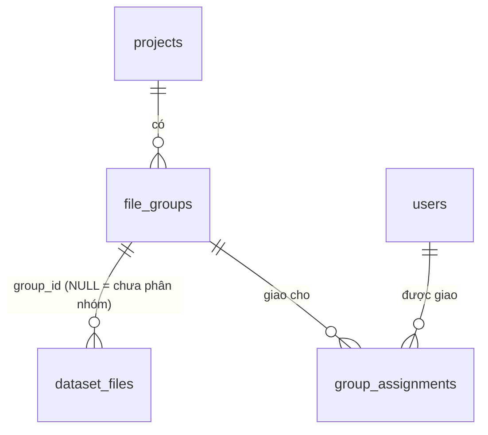

# Nhóm ảnh, phân công và nhập thư mục (mặc định / COCO 1.0)

Cập nhật: 2026-10-25. Trạng thái: đã code, có test tự động và E2E HTTP trên dev server cô lập; đã deploy Vercel 2026-10-25 (deployment `bitter-melon-annotation-q3f7ls3bn`, từ working tree, chưa commit); sau deploy đã đăng nhập ADMIN trên production và thấy Home theo nhóm. **Chưa kiểm thử tương tác đầy đủ trên trình duyệt** (nhập thư mục, hộp thoại phân công, bộ lọc).

## 1. Yêu cầu người dùng (xác nhận 2026-10-25)

1. Trình bày lại UX trang chính (Home) cho dễ dùng, giữ design hiện tại. **Chỉ sửa trang chính, không sửa trang editor gán nhãn.**
2. Admin giao việc (assign task) cho người dùng; giao diện người dùng chỉ thấy việc được giao cho mình.
3. Admin giao việc **theo nhóm**. Thư mục khổ qua có mỗi giống một thư mục con; khi admin tải cả thư mục lên, hệ thống tự tách mỗi thư mục con thành một nhóm.
4. Giao diện người gán nhãn hiển thị theo nhóm được giao; bấm vào nhóm thì hiện danh sách ảnh cần làm.
5. Tải lên dự án gồm ảnh, mask… theo định dạng **COCO 1.0**. Định dạng đang có (manifest) **không được xóa**, giữ làm **mặc định**; khi tải lên cho chọn COCO.

Các điểm dưới đây là **giả định của agent, chưa được người dùng xác nhận** (đổi được nếu người dùng muốn khác):

- REVIEWER được đối xử như ANNOTATOR: chỉ thấy nhóm được giao. Chỉ ADMIN thấy mọi thứ.
- Một nhóm giao được cho nhiều người; mô hình khóa hiện có vẫn bảo đảm mỗi ảnh chỉ một người sửa tại một thời điểm.
- Nút **Cập nhật Drive** và **Tải ZIP** ở Home giữ nguyên phạm vi cả dự án như trước (không lọc theo nhóm).
- Ảnh JPEG có EXIF xoay (orientation ≠ 1) bị từ chối khi nhập, vì trình duyệt hiển thị ảnh đã xoay còn mask tính theo pixel lưu trong tệp.

## 2. Mô hình dữ liệu (chỉ thêm, idempotent trong `db.ts`)

| Bảng/cột | Ý nghĩa |
| --- | --- |
| `file_groups(id, project_id, name, created_at, updated_at)`, `UNIQUE(project_id, name)` | Nhóm ảnh trong dự án (thường là một giống) |
| `group_assignments(group_id, user_id, assigned_by, created_at)`, PK `(group_id, user_id)` | Người được giao nhóm |
| `dataset_files.group_id` (TEXT NULL, FK `file_groups`) | Nhóm của ảnh. Dữ liệu có sẵn giữ `NULL` |

Bảng `assignments` (giao theo từng ảnh) có từ trước không có luồng ghi nào; quyền xem **không** dựa vào bảng này. Trường `FileListItem.assignment` giữ nguyên nghĩa cũ. Type mới: `FileGroupSummary`, `FileGroupList`, `UserSummary`, `DatasetImportResult`; `FileListItem.group?` (tùy chọn); `ErrorCode` thêm `INVALID_DATASET`.

## 3. Quyền xem theo nhóm

Vai trò đọc từ bảng `users` (không tin riêng JWT, vì JWT sống 24 giờ sau khi đổi vai trò). Biểu thức SQL nằm ở `src/lib/access-service.ts` và được nhúng vào truy vấn có sẵn, không thêm vòng truy vấn.

| Endpoint | ADMIN | Người khác |
| --- | --- | --- |
| `GET /api/projects` | Mọi dự án | Dự án có ít nhất một nhóm được giao |
| `GET /api/projects/:id/groups` | Mọi nhóm + người được giao + số ảnh chưa phân nhóm | Chỉ nhóm được giao; `assignees: []`, `ungrouped: 0` |
| `GET /api/projects/:id/files` | Mọi ảnh; `groupId=ungrouped` xem ảnh chưa phân nhóm | Chỉ ảnh thuộc nhóm được giao (áp cho cả Home, sidebar editor và Done & Next) |
| `GET /api/files/:id/editor` | Mọi ảnh | 403 `FORBIDDEN` nếu ảnh ngoài nhóm được giao |
| `POST /api/files/:id/lock` | Mọi ảnh | 403 `FORBIDDEN` nếu ảnh ngoài nhóm được giao |

Không đổi (có chủ đích):

- Heartbeat, lưu nháp, mask, Hoàn tất **không** kiểm tra lại phân công: bỏ giao giữa chừng không làm mất bản đang sửa; lần mở/xin khóa sau mới bị từ chối. Các thao tác ghi vẫn cần token khóa như cũ.
- Route asset (`/assets/image|prediction|thumbnail|current-mask`) chỉ yêu cầu đăng nhập như trước; ID ảnh là UUID chỉ lộ qua danh sách đã lọc. Ghi vào "Việc còn lại".
- Export ZIP/Drive giữ phạm vi cả dự án.
- Editor (`editor-workspace.tsx`, `editor-canvas.tsx`) **không sửa dòng nào**. Ảnh bị từ chối hiện màn "Không thể mở tệp" sẵn có kèm thông báo của server.

## 4. Trang chủ (Home)

Giữ token màu, bo góc, nút, thẻ ảnh theo UI Style Guide; chỉ sắp xếp lại luồng.

- **Thanh dự án**: tên/chọn dự án (chỉ hiện ô chọn khi có hơn một dự án), thanh tiến độ hoàn tất, Làm mới.
- **Người gán nhãn**: "Nhóm được giao cho bạn" → thẻ nhóm (số ảnh, thanh tiến độ, Chưa làm/Bản nháp/Hoàn tất, số ảnh đang được mở) → bấm **Mở nhóm** → danh sách ảnh của nhóm với bộ lọc có đếm số (Tất cả, Cần làm, Bản nháp, Hoàn tất, Đang được mở), tìm trong nhóm, nút **Làm ảnh tiếp theo** (ảnh chưa xong đầu tiên không ai đang mở). Ô "Tìm ảnh trong mọi nhóm" nằm ở trang tổng quan nhóm.
- **ADMIN** có thêm ba tab: *Nhóm & ảnh* (thẻ nhóm có danh sách người được giao, nút **Phân công**; thẻ **Chưa phân nhóm** với nút **Tự động chia nhóm** theo tên ảnh), *Nhập dữ liệu*, *Quản trị* (tạo dự án từ nguồn manifest và tạo người dùng như trước).
- Nhóm đang xem được nhớ theo dự án (`localStorage` khóa `last-group-id:<projectId>`), nên bấm về Home từ editor sẽ quay lại đúng nhóm.
- Panel **Dữ liệu dự án** (Kết nối Drive, Đồng bộ nguồn, Cập nhật Drive, Tải ZIP) giữ nguyên nút và câu chữ, đặt dưới danh sách nhóm. *Đồng bộ nguồn* ẩn với dự án tạo bằng tải thư mục (không có nguồn manifest). Drive vẫn chỉ ghi khi bấm *Cập nhật Drive* ở Home.
- Thẻ ảnh: bỏ dòng "Phụ trách/Chưa phân công" (luôn trống vì bảng `assignments` không được ghi); nút đổi theo trạng thái: Bắt đầu / Tiếp tục (bản nháp) / Chỉnh sửa lại / Chỉ xem.
- Bộ lọc cũ "Có thể làm" và "Của tôi" (dựa trên bảng `assignments` không được ghi) được thay bằng "Cần làm" (chưa hoàn tất) và nút Làm ảnh tiếp theo (chỉ chọn ảnh không ai đang mở). Tham số API `lockState=AVAILABLE`, `assignedTo=me` vẫn giữ nguyên cho nơi khác dùng.

## 5. Nhập thư mục

Luồng: trình duyệt đọc thư mục (`<input webkitdirectory>`) và lập kế hoạch (`src/lib/import-plan.ts`) → xem trước nhóm, cảnh báo, ánh xạ danh mục COCO → gửi **từng ảnh một request** `POST /api/projects/:id/import` (multipart, 3 request song song, dừng/thử lại ảnh lỗi). Mỗi request phải dưới giới hạn ~4.5 MB của Vercel; prelabel JSON được gzip ở trình duyệt (~10 lần nhỏ hơn). File COCO của cả bộ có thể vài chục MB nên chỉ đọc ở trình duyệt, không gửi lên server.

### 5.1 Chia nhóm

- **Theo thư mục con** (mặc định): nhóm = thư mục đầu tiên trên đường dẫn ảnh (tính từ thư mục được chọn) không phải thư mục cấu trúc `images`, `image`, `imgs`, `annotations`, `predictions`, `prelabels`, `masks`, `default`. Ví dụ `khoqua/8582/images/default/8582_01.jpg` → `8582`; `khoqua/images/8582/8582_01.jpg` → `8582`. Ảnh không nằm trong thư mục giống nào thuộc nhóm mang tên thư mục gốc.
- **Theo tên ảnh**: `8582_01` → `8582`, `TVI_8573_01` → `TVI_8573`, `8582_01_crop` → `8582` (`inferGroupName`). Dùng cho bố cục phẳng như `drive/prelabel-production`.
- Định dạng mặc định có thể ghi đè bằng trường tùy chọn `group` trong item manifest.
- Tên ảnh trùng giữa hai nhóm được lưu thành `<nhóm>_<tên>` (có cảnh báo); trùng trong cùng nhóm thì bỏ ảnh sau.

### 5.2 Định dạng mặc định (giữ nguyên định dạng đang dùng)

Mỗi `manifest.json` trong thư mục (`items[{ id, image, prediction, prelabel?, width?, height?, group? }]`), đường dẫn tính từ thư mục chứa manifest — giống hệt nguồn của *Đồng bộ nguồn*. Mask `prediction` là PNG cùng kích thước ảnh, giữ nguyên byte. Prelabel phải đúng schema `bitter-melon-prelabel-1.0/1.1` (cùng hàm kiểm tra `parsePrelabelOperations` mà editor dùng).

### 5.3 COCO 1.0

- Tìm file JSON có `images`, `annotations`, `categories` trong thư mục `annotations/` (hoặc tên `instances*.json`, `*coco*.json`, `annotation(s).json`). Gốc của bộ COCO là thư mục cha của `annotations/`. Hỗ trợ cả một file COCO cho từng giống (bố cục xuất CVAT `annotations/instances_default.json` + `images/default/`) lẫn một file cho cả thư mục.
- `file_name` được tìm theo `<gốc>/<file_name>`, `<gốc>/images/<file_name>`, rồi theo tên tệp duy nhất trong bộ; nhiều ảnh cùng tên thì báo cảnh báo, không đoán.
- **Ánh xạ danh mục** (admin chỉnh trước khi nhập): *Vết gợn (r\*)*, *U vấu (w\*)* hoặc *Bỏ qua*. Gợi ý: `wart`, `u vấu`, `w` → u vấu; `main_flesh_band`, `flesh`, `ridge`, `vết gợn`, `r` → vết gợn; còn lại bỏ qua.
- Mỗi annotation là một instance: mọi mảnh polygon của nó chung một label `r<n>`/`w<n>`, đánh số tăng dần theo thứ tự trong file. Label `attributes.label` hợp lệ (bản xuất COCO của chính tool) được giữ; số còn lại không trùng với chúng. `meta` = `{ semantic: main_flesh_band | wart_flesh, mainGroupId | wartId }`.
- Polygon: tọa độ lệch ra ngoài ảnh được kẹp về biên; mảnh dưới 3 điểm hoặc diện tích 0 bị bỏ (đếm và báo sau khi nhập).
- RLE (`counts` dạng mảng hoặc chuỗi nén pycocotools, theo cột): giải mã rồi vector hóa đúng pixel bằng `vectorizeBinaryMask`, giữ lỗ và các mảnh rời.
- Cùng phép đổi (`cocoImagePolygons` + `guessCategoryTarget`) dùng cho nút **Nhập JSON polygon / COCO 1.0** trong editor (từ 2026-10-25): nhập COCO cho riêng ảnh đang mở, không cần hộp thoại ánh xạ; xem [EDITOR_PIPELINE.md](EDITOR_PIPELINE.md) mục 10.
- Server dựng **mask gợi ý** PNG từ polygon bằng `rasterizePolygons` (tâm pixel, evenodd, không khử răng cưa) — cùng quy tắc của editor/export. Ảnh không có annotation nhận mask rỗng và prelabel `POLYGON_SET` rỗng.

### 5.4 Kiểm tra ở server (`dataset-import-service.ts`)

- Chỉ ADMIN (vai trò đọc từ DB). Ảnh JPEG/PNG/WebP; kích thước đọc từ chính tệp ảnh, không tin số liệu trong JSON; từ chối EXIF xoay. Mask phải là PNG đúng kích thước. Prelabel kiểm bằng `parsePrelabelOperations` (schema, kích thước, label `r*`/`w*`, ID không trùng, node trong ảnh). Mỗi phần ≤ 50 MB (gzip có giới hạn giải nén).
- Lưu ảnh, mask, prelabel qua `putObject` dưới `datasets/uploads/<project>/<ảnh>/<thời điểm>-<uuid>/`; tham chiếu `blob:<key>` (Blob/R2) hoặc đường dẫn tuyệt đối (backend filesystem khi dev) do `datasetObjectReference` tạo. Editor, thumbnail, export, version đọc như dataset đồng bộ từ manifest.
- Transaction khóa hàng `projects` nên các request song song của cùng dự án không tạo trùng dataset/nhóm/ảnh; khóa hàng `dataset_files` (`FOR UPDATE OF df`) trước khi kiểm khóa sửa, cùng thứ tự với `lock-service`.
- **Nhập lại** cùng tên ảnh: cập nhật ảnh/mask/prelabel/nhóm, **không đụng annotation đã lưu** (trạng thái, revision, version giữ nguyên). Từ chối (409) nếu ảnh đang có người giữ khóa sửa, hoặc ảnh đã có nhãn mà kích thước mới khác kích thước cũ.

## 6. Dữ liệu có sẵn khi triển khai

Ảnh đang có trên production chưa thuộc nhóm nào (`group_id` NULL) nên **sau khi deploy, người gán nhãn sẽ không thấy ảnh nào cho tới khi ADMIN chia nhóm và phân công**. Không có migration tự động. ADMIN làm trên Home:

1. Mở dự án → thẻ **Chưa phân nhóm** → **Tự động chia nhóm** (xếp theo tên ảnh `<giống>_<số>`; không đổi `updated_at` nên không làm mất cache ảnh/thumbnail; ảnh không đoán được tên vẫn ở Chưa phân nhóm).
2. Với từng nhóm → **Phân công** → chọn người gán nhãn → **Lưu phân công**.

## 7. Kiểm chứng (2026-10-25)

- Unit/tích hợp: `file-groups.test.ts`, `coco-import.test.ts` (RLE nén/không nén so với bản port `rleToString`, đọc lại COCO xuất bởi `coco-export`, vector hóa đúng pixel, prelabel qua `parsePrelabelOperations`), `import-plan.test.ts`, `group-access.test.ts` (route thật trên PGlite: lọc dự án/nhóm/ảnh, 403 khóa/editor, vai trò từ DB, phân công, tự chia nhóm), `dataset-import-service.test.ts` (PGlite + storage filesystem tạm: mask dựng đúng pixel, giữ byte PNG, từ chối EXIF/kích thước/schema, nhập lại giữ annotation, 409 khi đang khóa, nhập song song không trùng), `editor-prediction.test.ts` (403), `object-store.test.ts`, `api-client.test.ts`.
- E2E HTTP trên dev server cô lập (PGlite + storage trong thư mục tạm; `/api/health` xác nhận không có DB/Blob thật): 29/29 kiểm tra qua — nhập bộ COCO thử 2 giống, phân công, người được giao chỉ thấy nhóm của mình, người không được giao không thấy dự án, 403 với ảnh nhóm khác, mask gợi ý đúng 945 pixel; nhập **định dạng mặc định với 11 ảnh V7 thật** trong `drive/prelabel-production` (chỉ đọc) theo tên ảnh thành 11 nhóm, 84 polygon của `8582_01` tới editor nguyên vẹn, PNG prediction giữ nguyên byte; Home render và 16 chunk JS phía client tải được.
- **Chưa kiểm chứng**: thao tác trên trình duyệt (chọn thư mục, xem trước, hộp thoại phân công, bộ lọc, quay lại nhóm từ editor, giao diện hẹp/mobile); ghi lên Vercel Blob/R2 thật (E2E chỉ dùng backend filesystem); giới hạn 4.5 MB trên Vercel với ảnh gốc lớn; hiệu năng đọc file COCO rất lớn trên trình duyệt; dữ liệu production.

## 8. Việc còn lại

- Đổi tên, gộp, xóa nhóm; chuyển ảnh giữa nhóm bằng tay (hiện chỉ qua nhập lại hoặc tự chia nhóm).
- Kiểm tra phân công ở route asset nếu cần chặn tuyệt đối việc tải ảnh bằng ID.
- Quyết định có giới hạn *Cập nhật Drive*/*Tải ZIP* theo nhóm cho người gán nhãn hay không.
- Kéo-thả thư mục; nhập thư mục chỉ có ảnh (không manifest, không COCO); nhập ảnh > 4.5 MB trên Vercel (cần upload trực tiếp lên Blob/R2).
- Sidebar editor hiện mọi ảnh thuộc các nhóm được giao (không chỉ nhóm đang làm) vì editor không được sửa trong lần này.
- E2E trên trình duyệt cho toàn bộ luồng ở §4–§5.
