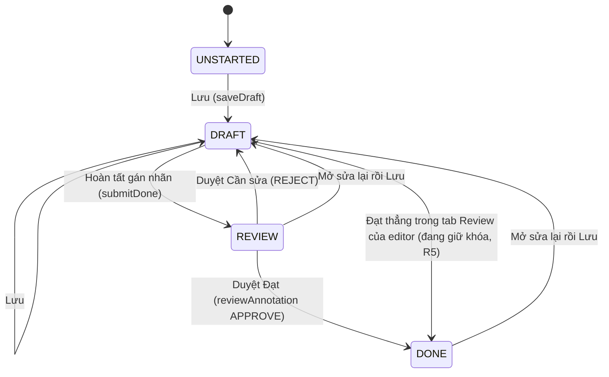
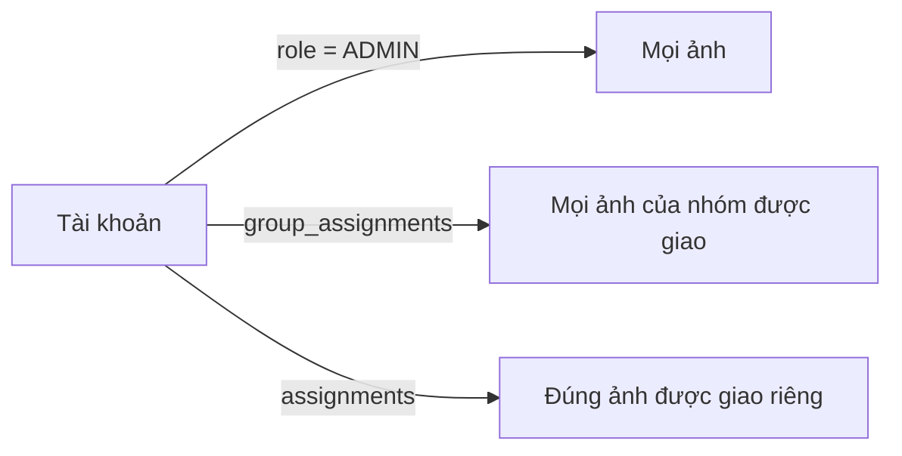
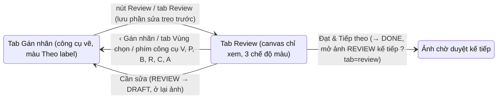

# Duyệt theo ảnh, phân công theo ảnh và lớp phủ duyệt

Cập nhật: 2026-11-24. Trạng thái: thiết kế được ghi **trước khi cài đặt** (người dùng yêu cầu "explore code và update docs SAD trước khi thực hiện"). Sau đó đã cài đặt và kiểm chứng (§7) trên test tự động, Chrome headless với dữ liệu tổng hợp và DB cô lập. **Chưa commit, chưa deploy; chưa thử trên dữ liệu/production thật.**

Đọc cùng [ARCHITECTURE.md](ARCHITECTURE.md) (yêu cầu 19–21), [GROUPS_AND_IMPORT.md](GROUPS_AND_IMPORT.md) (quyền theo nhóm) và [EDITOR_PIPELINE.md](EDITOR_PIPELINE.md) (lớp phủ).

## 1. Yêu cầu

| # | Yêu cầu | Nguồn |
| --- | --- | --- |
| R1 | Hoàn tất gán nhãn → ảnh sang **Cần review** (`REVIEW`); duyệt **Đạt** → **Hoàn thành** (`DONE`), **Cần sửa** → **Bản nháp** (`DRAFT`). Duyệt theo **ảnh**, không lưu quyết định từng mask; mọi vai trò có quyền xem ảnh đều duyệt được | Người dùng xác nhận 2026-11-17 (ghi theo comment trong code chưa commit của phiên đó: `annotation-service.ts`, `review-service.test.ts`, route `/review`) |
| R2 | **Admin giao việc ở mức từng ảnh** | Người dùng yêu cầu 2026-11-24 |
| R3 | Chức năng review có **nút lớp phủ tách nhanh 2 màu xanh – đỏ** (các mask cùng loại là các sắc gần nhau trên một dải màu), **chỉ cho u vấu (`w*`) và vết gợn (`r*`)** | Người dùng yêu cầu 2026-11-24 |
| R4 | **Một nút tách theo nóng – lạnh**: mỗi loại một nhóm nhiệt độ màu, nhưng từng label trong nhóm có màu khác nhau | Người dùng yêu cầu 2026-11-24 |
| R5 | **Tab Review ngay trong editor** cho mọi tài khoản, đổi qua lại tại chỗ như một trạng thái trên canvas. Nút "‹ Quay lại" cạnh **Hoàn tất & Tiếp theo** đổi thành nút **Review**. Hoàn tất & Tiếp theo giữ như cũ (→ Cần review, sang ảnh kế tiếp). Trong tab Review được **Đạt thẳng từ Bản nháp**. Nút Duyệt ở Home và trang `/review/:id` giữ nguyên | Người dùng yêu cầu 2026-11-25; chọn 3 phương án: đổi tab tại chỗ, cho Đạt thẳng từ Bản nháp, giữ cả trang `/review` (§4b) |

**Giả định của agent, chưa được người dùng xác nhận** (đổi bằng hằng số ở đầu `src/lib/review-colors.ts`, không ảnh hưởng dữ liệu):

- Vết gợn `r*` = **đỏ / nhóm nóng**, u vấu `w*` = **xanh / nhóm lạnh**. Lý do: cùng hướng với hue gốc đang dùng trong `label-colors.ts` (`r` 12°, `w` 192°).
- "Xanh" = **xanh dương** (~218°), không phải xanh lá: ảnh khổ qua chủ yếu xanh lá nên mask xanh lá chìm vào nền. `label-colors.ts` cũng đã bỏ dải hue 65°–175° vì lý do này. Nhóm lạnh vì thế đi cyan → xanh dương → tím (180°–290°), nhóm nóng đi hồng → đỏ → cam → hổ phách (320°–55°). Cả hai đều tránh dải xanh lá.
- Mỗi ảnh có **tối đa một** người phụ trách riêng (giao lại sẽ thay người cũ). Phân công theo ảnh **cộng thêm** vào phân công theo nhóm, không thu hẹp quyền của người đã được giao cả nhóm.
- Chỉ giao riêng được ảnh **đã thuộc nhóm**. Lý do: Home của người gán nhãn tổ chức theo nhóm (yêu cầu 9), nên ảnh chưa phân nhóm sẽ không có chỗ hiển thị.
- ~~Nút màu duyệt chỉ có ở trang duyệt~~ (thay bởi R5, 2026-11-25): tab **Gán nhãn** của editor vẫn chỉ có "Theo label" (yêu cầu 14). Ba nút màu chỉ có ở tab **Review** và trang `/review`.

## 2. Vòng đời trạng thái ảnh (R1)



- `reviewAnnotation(fileId, userId, decision, revision)` chạy trong transaction: khóa hàng `dataset_files`, kiểm quyền (`FILE_ACCESS_SQL`), trạng thái phải là `REVIEW`, `revision` phải bằng `latest_revision`, và không ai khác đang giữ khóa sửa. Hàm chỉ đổi `annotations.status` và `dataset_files.annotation_state`. Revision, version và `segmentation_json` giữ nguyên.
- **Đạt thẳng từ Bản nháp (R5, 2026-11-25):** `reviewAnnotation(..., lockToken?)`. `APPROVE` trên ảnh `DRAFT` chỉ được khi request mang header `X-Annotation-Lock-Token` của khóa **còn hạn mà chính người đó đang giữ**. Trường hợp này chỉ xảy ra trong editor, ngay sau khi editor lưu xong. Không có token, token sai/hết hạn hoặc của người khác thì vẫn trả `NOT_IN_REVIEW` như cũ. `REJECT` vẫn chỉ từ `REVIEW`, ảnh `UNSTARTED`/`DONE` vẫn không kết luận được. Revision, version và dữ liệu giữ nguyên. Khóa không bị nhả; editor tự nhả khi chuyển ảnh. Version cuối của ảnh vì thế vẫn mang nhãn "Bản lưu", không phải "Hoàn tất".
- Export *(sửa lại 2026-11-25 cho đúng code)*: `export-service.ts` lấy **mọi ảnh trừ `UNSTARTED`**, tức là có cả `REVIEW`. Câu cũ "ảnh `REVIEW` không có trong ZIP đầy đủ/Drive (bộ lọc `status IN ('DRAFT','DONE')`)" sai: không có bộ lọc đó trong code. Gói "Tải ảnh hoàn tất" chỉ lấy `DONE` (`completed-export-service.ts`, `a.status = 'DONE'`). *Cần người dùng xác nhận* hành vi này có đúng ý không (ghi ở §8).

## 3. Phân công theo ảnh (R2)

### 3.1 Dữ liệu — không đổi schema

Dùng lại bảng `assignments(id, dataset_file_id, user_id, assigned_by, created_at)` và index `idx_assignments_file_user`. Bảng này có trong schema từ đầu nhưng tới nay chưa có luồng ghi nào. Không thêm bảng/cột/ràng buộc. Ràng buộc "một ảnh tối đa một người" do service bảo đảm: trong một transaction, khóa các hàng `dataset_files` (`FOR UPDATE`), xóa phân công cũ của các ảnh đó, rồi chèn phân công mới.

`FileListItem.assignment` (người phụ trách đầu tiên theo `created_at`) giữ nguyên nghĩa. Trước đây trường này luôn trống; từ nay nó có dữ liệu.

### 3.2 Quyền xem (cộng thêm)



| Biểu thức (`access-service.ts`) | Trước | Sau |
| --- | --- | --- |
| `FILE_ACCESS_SQL` (alias `df`) | ADMIN ∨ được giao nhóm `df.group_id` | ADMIN ∨ được giao nhóm ∨ **được giao riêng `df.id`** |
| `GROUP_ACCESS_SQL` (alias `g`) | ADMIN ∨ được giao nhóm `g.id` | ADMIN ∨ được giao nhóm ∨ **có ảnh được giao riêng trong nhóm** |
| `PROJECT_ACCESS_SQL` (mới, alias `p`) | (viết lặp ở `GET /api/projects` và `completed-export-service`) | ADMIN ∨ có nhóm được giao ∨ **có ảnh được giao riêng** trong dự án |

- **Giữ đúng hai tham số `(userId, userId)`** cho cả ba biểu thức. Lần nhắc thứ hai đọc từ một hàng `users` theo khóa chính, nên mọi chỗ gọi hiện có không phải sửa. Danh sách chỗ dùng (Grep 2026-11-24): routes `editor`, `lock`, `projects`, `projects/:id/files`; `annotation-service.reviewAnnotation`; `completed-export-service`; `group-service.listGroups`.
- **Tiến độ nhóm** (`listGroups`) chỉ đếm ảnh mà người xem có quyền: điều kiện `FILE_ACCESS_SQL` nằm trong `LEFT JOIN dataset_files`. Số liệu của ADMIN và của người được giao cả nhóm **không đổi**. Người chỉ được giao riêng 3 ảnh của nhóm 50 ảnh sẽ thấy nhóm đó với 3 ảnh.
- Như phân công theo nhóm: bỏ giao **không cắt phiên đang sửa**. Bootstrap và xin khóa lần sau mới bị từ chối; heartbeat, lưu và Hoàn tất không kiểm lại phân công.

### 3.3 API

`PUT /api/projects/:projectId/files/assignee` — chỉ ADMIN (vai trò đọc từ DB).

```json
{ "fileIds": ["<id>", "…"], "userId": "<id> | null" }
```

- `userId: null` = bỏ giao riêng. Nhận 1–500 ảnh trong một lần gọi, ID không trùng.
- Trả `{ updated: number, assignee: { userId, displayName } | null }`.
- 400 `INVALID_DATASET`: body sai, tài khoản không tồn tại, hoặc có ảnh chưa thuộc nhóm. 404 `FILE_NOT_FOUND`: có ảnh không thuộc dự án. Khi có lỗi thì không ghi gì (một transaction).
- Service: `src/lib/file-assignment-service.ts` (`setFileAssignee`).

### 3.4 Giao diện

- **ADMIN, trong danh sách ảnh của một nhóm:** mỗi thẻ ảnh có ô chọn dạng chip nổi ở góc trên phải ảnh (không chiếm dòng trong thân thẻ; người dùng yêu cầu 2026-11-24) và dòng "Phụ trách: <tên>" hoặc "Chưa giao riêng". Thanh thao tác ghi "Đã chọn N ảnh", có ô chọn người phụ trách và các nút **Giao**, **Bỏ giao riêng**, **Chọn cả trang**, **Bỏ chọn**. Danh sách người chỉ gồm tài khoản không phải ADMIN, như hộp thoại phân công nhóm.
- **Người không phải ADMIN:** thẻ ảnh hiện "Giao cho bạn" hoặc "Giao cho <tên>".
- **Làm ảnh tiếp theo** (Home) và **Done & Next** (editor) ưu tiên ảnh giao cho mình và bỏ qua ảnh giao riêng cho người khác. Done & Next đã có logic này từ trước (`claimNextAvailableFile`); Home bổ sung cho khớp. Ảnh giao cho người khác vẫn mở được bằng tay.

## 4. Trang duyệt `/review/[fileId]` (R1, R3, R4)

- Dashboard đã có nút **Duyệt** trỏ tới `/review/:id` cho ảnh `REVIEW`, nhưng trước 2026-11-24 chưa có trang này (404).
- `src/app/review/[fileId]/page.tsx` kiểm cookie như trang editor rồi render `src/components/review-workspace.tsx`.
- **Không xin khóa, không heartbeat, không ghi IndexedDB.** Trang đọc `GET /api/files/:id/editor` (bootstrap chỉ đọc, đã kiểm quyền) và hiển thị `EditorCanvas` với `readOnly` + công cụ `pan`: kéo để di chuyển, con lăn để zoom, có nút +/−/Vừa khung.
- Panel phải gồm:
  - Thông tin ảnh: tên, trạng thái, revision, người sửa cuối, số mask/label vết gợn và u vấu.
  - Lớp phủ: bật/tắt, độ mờ, và nhóm 3 nút **Theo label · Xanh – Đỏ · Nóng – Lạnh** kèm chú giải màu.
  - Kết luận: **Đạt** (`APPROVE`) / **Cần sửa** (`REJECT`), gọi `POST /api/files/:id/review` với revision đang xem.
- Sau khi kết luận: hiện kết quả, nút **Ảnh cần duyệt tiếp theo** (ảnh `REVIEW` kế tiếp không ai đang mở) và nút **Về Home**.
- Lỗi lấy từ server, không đoán:
  - 409 `REVISION_CONFLICT`: ảnh đã đổi, cần tải lại.
  - 423 `FILE_LOCKED`: người khác đang sửa.
  - 409 `NOT_IN_REVIEW`: ảnh không còn chờ duyệt.
  - 403: ngoài phạm vi được giao.
- Annotation chỉ có raster (ACCEPTED/UNTOUCHED, không có polygon) chỉ tô được một màu. Panel ghi rõ "không tách màu theo label được".
- Trang duyệt mở mặc định ở **Xanh – Đỏ** (mục đích chính của trang là tách nhanh hai loại). Chế độ đã chọn được nhớ theo trình duyệt (`localStorage` khóa `review-color-mode`). Độ mờ dùng chung khóa `mask-opacity` với editor.
- Panel không hiện "người sửa cuối", vì bootstrap chỉ có user id (UUID), không có tên. Muốn hiện tên thì phải mở rộng API; chưa làm.

## 4b. Tab Review trong editor (R5, 2026-11-25)



- **Không có route mới.** Toàn bộ nằm trong `editor-workspace.tsx` (state `panelTab`). `/editor/:id?tab=review` mở thẳng tab Review: `page.tsx` đọc `searchParams` và truyền `initialTab`.
- **Đổi tab không đổi dữ liệu.** Khi sang Review, editor flush rồi lưu phần sửa còn treo (đúng save policy hiện có: lưu khi đổi tab). Nhờ vậy trạng thái và revision trên panel khớp với bản đang xem. Không còn gì để lưu thì không có request nào; E2E đã kiểm.
- **Canvas ở tab Review:** `readOnly` + công cụ `pan`. Prop `colorMode` lấy chế độ đã chọn (nhớ chung khóa `review-color-mode` với trang `/review`, mặc định Xanh – Đỏ). Thanh công cụ vẽ và thanh Paint ẩn, nút Vừa khung chuyển lên cụm zoom. Ở tab Gán nhãn canvas vẫn nhận `'label'`.
- **Panel phải:** tiêu đề "Duyệt ảnh"; trạng thái ảnh trên server (`fileState`); số mask/label `r*`/`w*` tính từ polygon đang hiển thị; 3 nút màu + chú giải; mục Kết luận có câu hướng dẫn theo trạng thái và nút **Cần sửa · trả về Bản nháp**. Phần màu và chú giải là component dùng chung `src/components/review-color-controls.tsx` với trang `/review`.
- **Chân panel:**

| Tab | Nút trái | Nút chính |
| --- | --- | --- |
| Gán nhãn | **Review** (thay "‹ Quay lại"; về danh sách vẫn bằng icon thư mục) | **Hoàn tất & Tiếp theo →** (không đổi) |
| Review, ảnh chưa Hoàn thành | **‹ Gán nhãn** | **Đạt & Tiếp theo →** |
| Review, ảnh đã Hoàn thành hoặc đang chỉ xem | **‹ Gán nhãn** | **Ảnh cần duyệt tiếp theo →** |

  Tab Review không có Hoàn tất vì bấm Hoàn tất trên ảnh vừa duyệt Đạt sẽ đưa ảnh về lại `REVIEW`.
- **Đạt & Tiếp theo:**
  1. Chặn nếu mask chưa được chấp nhận/chỉnh (giống Hoàn tất).
  2. Lưu phần sửa treo.
  3. `POST /api/files/:id/review` với `revisionRef`. `apiFetch` tự gắn lock token nên server cho Đạt thẳng từ Bản nháp.
  4. Tìm ảnh `REVIEW` kế tiếp còn trống, giống nút cùng tên ở `/review`, rồi `navigateTo('/editor/<id>?tab=review')` (nhả khóa ảnh vừa duyệt).
  5. Không còn ảnh nào thì ở lại, báo rõ, và nút chính đổi thành Ảnh cần duyệt tiếp theo.
- **Cần sửa:** chỉ bật khi ảnh là `REVIEW`. Ảnh về `DRAFT`, editor **ở lại ảnh và chuyển về tab Gán nhãn**, vẫn giữ khóa, để sửa ngay.
- **Chỉ xem** (người khác giữ khóa): vẫn đổi tab và đổi màu được, nhưng không kết luận. Câu hướng dẫn nêu ai đang sửa; nếu là phiên khác của chính mình thì gợi ý "Sửa tại đây".
- Bấm ảnh ở sidebar trái khi đang ở tab Review thì ảnh mới cũng mở ở tab Review.
- "Hoàn tất & Tiếp theo" ở tab Gán nhãn không đổi: lưu → `REVIEW` → nhả khóa → nhận ảnh chưa xong kế tiếp.

## 5. Chế độ màu lớp phủ (R3, R4)

Module thuần `src/lib/review-colors.ts`: `overlayColor(label, mode)`, `type OverlayColorMode = 'label' | 'twoTone' | 'warmCool'`.

| Chế độ | Vết gợn `r<n>` | U vấu `w<n>` | Label khác |
| --- | --- | --- | --- |
| `label` (mặc định; editor chỉ dùng chế độ này) | `labelColor` như cũ | `labelColor` như cũ | `labelColor` như cũ |
| `twoTone` — **Xanh – Đỏ** | đỏ: hue 0° ± 8°, sáng 44 → 62 % theo bậc `(n−1) mod 5` (các sắc gần nhau) | xanh dương: hue 218° ± 8°, cùng bậc sáng | xám trung tính |
| `warmCool` — **Nóng – Lạnh** | nhóm nóng 320° → 55° (qua 0°); hue rải theo dãy tỉ lệ vàng `frac(n·0.618…)` nên các số liền nhau cách xa; độ sáng luân phiên 3 mức | nhóm lạnh 180° → 290°, cùng cách rải | xám trung tính |

Bất biến:

- Cùng label → cùng màu ở mọi chế độ (giữ quyết định 2026-11-05). Màu chỉ phụ thuộc chuỗi label và chế độ.
- Mọi màu `r*` nằm trong dải đỏ/nóng, mọi màu `w*` nằm trong dải xanh/lạnh, và không màu nào rơi vào dải xanh lá 65°–175°.
- Chỉ ảnh hưởng hiển thị: không lưu vào annotation, không ảnh hưởng export/ZIP/Drive.
- Polygon khóa giữ tô trắng, viền xám; bản nháp giữ màu riêng.

Canvas (`editor-canvas.tsx`) có thêm prop tùy chọn `colorMode` (mặc định `'label'`). Hai chỗ đang gọi `labelColor(polygon.label)` (phần tô ở lớp mask và viền ở lớp vector) đổi sang `overlayColor(polygon.label, colorMode)`. Khi `colorMode` đổi, canvas vẽ lại lớp mask và lớp vector, không vẽ lại ảnh. Editor truyền `'label'` ở tab Gán nhãn (hành vi cũ) và chế độ đã chọn ở tab Review (R5, 2026-11-25).

## 6. Ảnh hưởng đã xét

| Vùng | Ảnh hưởng | Kiểm tra |
| --- | --- | --- |
| `access-service.ts` (rủi ro cao: quyền) | Thêm nhánh giao riêng vào 2 biểu thức, thêm `PROJECT_ACCESS_SQL`; giữ số tham số | `group-access.test.ts` (giữ nguyên kỳ vọng), test mới cho giao riêng, `review-service.test.ts`, `completed-export-service.test.ts` |
| `group-service.listGroups` | Đếm trong phạm vi quyền | Kỳ vọng cũ trong `group-access.test.ts` giữ nguyên |
| Route `projects`, `completed-export-service` | Dùng `PROJECT_ACCESS_SQL` thay câu lặp | Test hiện có + test mới |
| `editor-canvas.tsx` | Prop tùy chọn `colorMode`, mặc định giữ hành vi cũ | `canvas-browser-check` (thêm cảnh `?colors=`), toàn bộ kiểm tra cũ |
| `dashboard.tsx` | Ô chọn + thanh giao riêng (ADMIN), dòng phụ trách, Làm ảnh tiếp theo bỏ ảnh của người khác | Kiểm tay/headless nếu chạy được, nếu không ghi "chưa kiểm thử UI" |
| Lock, lưu, Hoàn tất, save policy, Drive | Không đổi | Toàn bộ test |
| Dữ liệu cũ | Bảng `assignments` trên production được ghi lần đầu khi ADMIN bấm Giao; không có migration | — |

## 7. Kiểm chứng (2026-11-24)

**Bốn cổng** (trong `annotation-tool/`): `npm run typecheck` sạch, `npm run lint` sạch, `npm test` **387 test / 39 file** qua (baseline trước khi sửa: 368 / 37, đã gồm `review-service.test.ts`), `npm run build` qua (có route `/review/[fileId]` và `/api/projects/[projectId]/files/assignee`).

**Test mới:**

- `review-colors.test.ts` (10 test):
  - chế độ `label` trùng hệt `labelColor`;
  - cùng label cùng màu;
  - r\* luôn đỏ ±8°, w\* luôn xanh dương ±8°, các label liền nhau chỉ lệch sắc nhẹ;
  - Nóng – Lạnh: r\* trong dải nóng, w\* trong dải lạnh, các label liền nhau cách ≥ 30°, 60 label không trùng màu;
  - không màu nào rơi vào dải xanh lá; label khác tô xám;
  - `reviewLabelSummary`.
- `file-assignment-service.test.ts` (9 test, route thật trên PGlite):
  - giao riêng làm hiện dự án/nhóm/ảnh, nhóm chỉ đếm ảnh của mình;
  - mở/khóa được đúng ảnh được giao, ảnh khác cùng nhóm vẫn 403;
  - người được giao cả nhóm và ADMIN thấy số liệu không đổi;
  - giao lại thay người cũ (một hàng mỗi ảnh); bỏ giao thu hồi quyền;
  - người duyệt được giao riêng thì duyệt được;
  - ảnh chưa có nhóm bị từ chối và cả lô không ghi; ảnh dự án khác → 404; body sai → 400; không phải ADMIN theo DB → 403.
- `group-access.test.ts`, `review-service.test.ts`, `completed-export-service.test.ts` giữ nguyên kỳ vọng và vẫn qua sau khi đổi biểu thức quyền.

**`canvas-browser-check`** (Chrome headless, trang dữ liệu giả, dev server với DB/Blob giả):

- 3 kiểm tra mới trên cảnh `?labels=1` đều qua:
  - Xanh – Đỏ: hai mask r1 cùng màu đỏ, w1 xanh;
  - Nóng – Lạnh: r1 nóng, w1 lạnh, khác màu của Xanh – Đỏ;
  - quay về Theo label: đúng màu cũ của editor.
- Tổng **83/84**. Kiểm tra đỏ duy nhất là *"a second cut joining the pending one separates the mask"*, nằm trong phần sửa nhấp đúp chưa commit ngày 2026-11-17 (logic này không đổi trong lần này). Nó đỏ ổn định 3/3 lần chạy, lần nào cũng báo "Cần 2 điểm".
  - Nguyên nhân: script chấm lại đúng điểm vừa hoàn tất bằng nhấp đúp sau khoảng 400 ms + thời gian đọc trạng thái. Guard `draftCompletedAtRef` của canvas bỏ qua cú nhấp ở cùng chỗ trong vòng 500 ms sau khi hoàn tất.
  - Một bản copy script trong scratchpad, chỉ chèn thêm 300 ms trước đường cắt thứ hai, chạy **84/84**.
  - Chưa sửa guard hay test, vì đây là hành vi của phần việc khác và cần người dùng quyết định (ghi ở §8).
- Phát hiện trong lúc làm: hàng nút của trang kiểm tra đã tràn quá cửa sổ 1280 px. Các nút màu đặt ở hàng đó thì nằm ngoài màn hình và click chuột thật không trúng, nên đã chuyển chúng sang khối `position: fixed` không làm đổi layout canvas.

**E2E cô lập trên Chrome headless — 32/32 qua.**

Môi trường: dev server với PGlite + filesystem trong thư mục tạm, mọi biến production để rỗng. `/api/health` xác nhận `database:false`, `blob:false`, không có Drive/OAuth, fingerprint `null` trước khi ghi. Ảnh PNG tổng hợp đi qua API thật: nhập ảnh → khóa → Hoàn tất → `REVIEW`. Các bước đã qua:

- **ADMIN giao riêng từng ảnh:**
  - Home có ô chọn ảnh và thanh giao; danh sách người không có ADMIN; nút Giao tắt khi chưa chọn.
  - Giao xong có thông báo, thẻ ảnh hiện "Phụ trách: an", thẻ khác hiện "Chưa giao riêng", lựa chọn được xóa.
- **Người được giao:**
  - "an" chỉ thấy đúng ảnh được giao (API và Home); nhóm chỉ đếm 1 ảnh; không có ô chọn/thanh giao.
  - Mở `/review` một ảnh ngoài phạm vi thì gặp màn lỗi.
- **Trang duyệt (ADMIN):**
  - Đếm đúng 3 mask/2 label vết gợn, 2 mask/2 label u vấu; chú giải có 2 ô màu mỗi loại.
  - Ba chế độ cho ba hình canvas khác nhau; quay lại Xanh – Đỏ cho ảnh chụp giống từng byte.
  - **Không có** request khóa, heartbeat hay lưu.
- **Kết luận:**
  - Bấm Đạt → server `DONE`, đúng một request duyệt, hai nút bị khóa sau đó.
  - Ảnh chưa làm: nút tắt, có giải thích, báo "chỉ có mask raster".
  - Không có lỗi console.
- Đã xem ảnh chụp desktop (1366 px) của trang duyệt và Home; đã sửa nút "Đang bật" bị bóp còn 25 px và nhãn "Người phụ trách" bị xuống dòng.

Sau khi chạy: đã dừng server, xóa đúng 6 thumbnail do lần thử tạo trong `annotation-storage/thumbnails` (đối chiếu danh sách trước/sau). DB và storage tạm nằm ngoài repo.

**Chưa kiểm chứng:**

- Dữ liệu và ảnh khổ qua thật (hàng trăm mask, nền xanh lá thật, mức độ dễ phân biệt màu ở độ mờ 50 %).
- Postgres/Neon thật: hiệu năng biểu thức quyền mới trên bảng lớn, giao 500 ảnh một lần.
- Màn hẹp/mobile của trang duyệt; Safari/Firefox; thiết bị thật.
- Bấm "Cần sửa" và "Ảnh cần duyệt tiếp theo" trên trình duyệt (chỉ có test service cho REJECT).
- Bộ lọc/tiến độ khi một người vừa được giao nhóm vừa được giao riêng ảnh ở nhóm khác (chỉ có test service).

## 7b. Kiểm chứng tab Review trong editor (2026-11-25)

**Bốn cổng** (trong `annotation-tool/`): `npm run typecheck` sạch, `npm run lint` sạch, `npm test` **392 test / 39 file** qua, `npm run build` qua.

**Test mới** (`review-service.test.ts`, 11 test, trước là 9):

- Đạt thẳng từ Bản nháp: không token, token sai, token của người khác, `REJECT`, revision lệch đều bị từ chối và trạng thái giữ nguyên. Đúng token thì `DONE`; revision, số version và `segmentation_json` giữ nguyên; khóa vẫn còn.
- Khóa hết hạn: bị từ chối, ảnh vẫn `DRAFT`.

**`canvas-browser-check`** (canvas không đổi code, chạy để chắc chắn): 83/84, đúng như baseline 2026-11-24. Ô đỏ duy nhất vẫn là kịch bản đường cắt thứ hai (guard 500 ms, chờ người dùng quyết, §8); không có ô đỏ mới.

**E2E cô lập trên Chrome headless — 30/30 qua.**

Môi trường: dev server với PGlite + filesystem trong thư mục tạm, mọi biến production để rỗng. Script dừng nếu `/api/health` không báo `database:false`, `blob:false`. Dữ liệu dựng qua API thật: 3 ảnh PNG tổng hợp, ảnh A ở Bản nháp (2 mask `r*`, 1 mask `w*`), ảnh B, C ở Cần review. Các bước đã qua:

- Tab Gán nhãn: chân panel là **Review** + **Hoàn tất & Tiếp theo**, không còn "Quay lại"; thanh tab có Vùng chọn · Review.
- Sang tab Review:
  - Tiêu đề "Duyệt ảnh", chip "Review · chỉ xem", thanh công cụ vẽ ẩn, có nút Vừa khung.
  - Đếm đúng "2 mask · 2 label" / "1 mask · 1 label", trạng thái Bản nháp. Cần sửa tắt.
  - Mặc định Xanh – Đỏ. Ba chế độ cho ba hình canvas khác nhau; quay lại Xanh – Đỏ cho ảnh chụp giống từng byte.
  - Đổi tab và đổi màu **không** sinh request lưu, duyệt hay khóa nào.
- Phím V ở tab Review quay về Gán nhãn.
- **Đạt & Tiếp theo trên ảnh Bản nháp:** đúng một request duyệt; server A `DONE` và đã nhả khóa; mở ảnh chờ duyệt kế tiếp ở `?tab=review`, trạng thái Cần review.
- **Cần sửa:** ở lại ảnh, về tab Gán nhãn, có thông báo; server `DRAFT`, khóa vẫn thuộc editor.
- **Ảnh đã Hoàn thành ở tab Review:** nút chính là "Ảnh cần duyệt tiếp theo"; bấm thì sang ảnh `REVIEW` còn lại, bỏ qua ảnh vừa về Bản nháp; trạng thái A không đổi.
- **Đạt khi không còn ảnh chờ duyệt:** ở lại, báo "Không còn ảnh chờ duyệt…", trạng thái đổi thành Hoàn thành, nút chính đổi.
- Trang `/review` (đã chuyển sang component dùng chung) vẫn hiện 3 chế độ + chú giải; ảnh Bản nháp không kết luận được ở đó.
- Không có lỗi console. Đã xem ảnh chụp desktop (1366 px) của cả hai tab.

Sau khi chạy: đã dừng server; `annotation-storage/thumbnails` và `annotation-storage/masks` trong repo không có thêm file nào (đối chiếu danh sách trước/sau). DB và storage tạm nằm ngoài repo.

**Chưa kiểm chứng (tab Review):**

- Dữ liệu và ảnh khổ qua thật; Postgres/Neon thật; production.
- Màn hẹp/mobile của tab Review; Safari/Firefox; thiết bị thật.
- Editor ở chế độ chỉ xem (người khác giữ khóa) với tab Review; Đạt khi mạng chập chờn hoặc lưu bị xung đột (chỉ đọc code: lưu thất bại thì không gửi kết luận).
- Tài khoản ANNOTATOR/REVIEWER trong trình duyệt. E2E dùng ADMIN; quyền theo vai trò chỉ có test service.

## 8. Việc còn lại / cần người dùng quyết định

- Xác nhận các giả định ở §1: màu nào cho loại nào, xanh dương hay xanh lá, một người phụ trách mỗi ảnh, chỉ giao ảnh đã có nhóm.
- Ảnh `REVIEW` hiện **có** trong ZIP đầy đủ/Drive (export lấy mọi ảnh trừ `UNSTARTED`; tài liệu cũ ghi ngược, đã sửa 2026-11-25). Cần xác nhận giữ như vậy hay chỉ xuất `DRAFT` + `DONE`.
- Có cần bộ lọc "Giao cho tôi" ở Home không. (Ba nút màu đã có trong editor ở tab Review, R5.)
- Tab Review (R5): Đạt thẳng từ Bản nháp không tạo version "Hoàn tất" (version cuối vẫn là "Bản lưu"). Cần xác nhận có muốn đổi nhãn version không. Ảnh kế tiếp sau Đạt là ảnh `REVIEW` còn trống đầu tiên, không ưu tiên ảnh giao cho mình.
- Người gán nhãn tự Đạt ảnh của chính mình được (đúng R1: mọi vai trò có quyền xem đều duyệt được). Nếu muốn tách người duyệt khỏi người gán nhãn thì cần một luật mới.
- Ghi người duyệt và thời điểm duyệt: hiện không lưu, đúng như R1 (chỉ đổi nhãn trạng thái).
- `canvas-browser-check` đang đỏ 1 kiểm tra (đường cắt thứ hai bắt đầu đúng tại điểm vừa hoàn tất bằng nhấp đúp, trong vòng 500 ms) — §7. Cần người dùng chọn: (a) giữ guard 500 ms và nới nhịp script (sửa test, cần duyệt), hoặc (b) thu hẹp guard để cú nhấp mở đầu đường mới tại điểm vừa hoàn tất vẫn được chấm.
